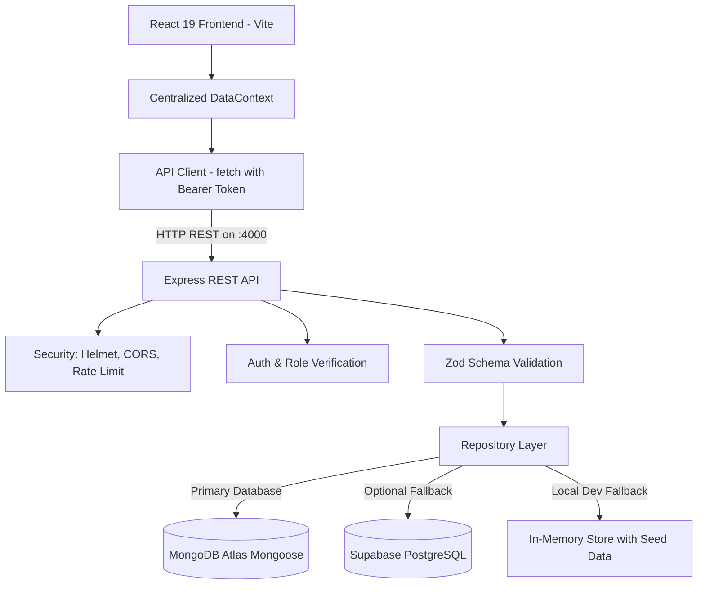

# 🎮 ClusterHub — Gaming Tournament & Match Management System

<div align="center">

**Organize tournaments. Manage matches. Track the competition.**

A modern, full-stack esports and gaming tournament management platform connecting games, tournaments, teams, registrations, match fixtures, and real-time leaderboards.

<br>


<br>

[Live Portal](https://cluster-hub-uikz.vercel.app/) · [Repository](https://github.com/Ahad-Panhwer/ClusterHub) · [Source Code](https://github.com/Ahad-Panhwer/ClusterHub/tree/main) · [Report an Issue](https://github.com/Ahad-Panhwer/ClusterHub/issues)

</div>

---

## 📌 Architecture & System Flow



ClusterHub uses a clean full-stack monorepo architecture:
- **`frontend/`**: React 19 + TypeScript + Vite + Tailwind CSS v4 with glassmorphism dark gaming UI.
- **`backend/`**: Node.js + Express + TypeScript REST API with MongoDB Atlas (via Mongoose models), full validation, authorization, and dual base path support (`/api/*` and `/api/v1/*`).
- **`database/`**: Versioned database schemas and SQL migrations for optional PostgreSQL / Supabase deployments.
- **`docs/`**: Complete engineering specifications, API contracts, Vercel deployment guide, and database schemas.

---

## 📂 Repository Structure

```text
ClusterHub/
├── package.json               # Root workspace scripts (run both frontend and backend)
├── render.yaml                # 1-click Render blueprint deployment specification
├── README.md                  # Master documentation
├── .gitignore                 # Root Git exclusion rules
│
├── frontend/                  # React 19 + TypeScript Web UI
│   ├── package.json
│   ├── vite.config.ts         # Vite bundler configuration
│   ├── netlify.toml           # Netlify SPA rewrite configuration
│   ├── .env.example           # Example environment variables
│   ├── .env.local             # Local environment configuration (points to port 4000)
│   ├── public/
│   │   └── _redirects         # Single Page Application routing rewrite rule
│   └── src/
│       ├── components/        # Layout (TopNav, Sidebar), charts, and UI primitives
│       ├── context/           # AuthContext (Abdul Ahad profile), DataContext, ToastContext
│       ├── pages/             # Dashboard, Games, Tournaments, Matches, Teams, Registrations, Leaderboard, Settings, Auth
│       ├── services/          # apiClient, gamesService, tournamentsService, matchesService, etc.
│       └── types/             # Shared TypeScript type definitions
│
├── backend/                   # Node.js + Express + TypeScript REST API
│   ├── package.json
│   ├── tsconfig.json
│   ├── jest.config.js         # Jest ESM configuration
│   ├── .env.example           # Environment template
│   ├── src/
│   │   ├── app.ts             # Express app setup, middleware, and route mounting
│   │   ├── server.ts          # Server listener on port 4000
│   │   ├── config/            # Environment variable validation & Supabase auto-detection
│   │   ├── lib/               # In-memory store fallback and Supabase client
│   │   ├── middleware/        # auth, errorHandler, validate
│   │   ├── repositories/      # Games, Tournaments, Matches, Teams, Registrations repositories
│   │   ├── routes/            # Express routers for all CRUD modules
│   │   ├── types/             # Backend TypeScript interfaces
│   │   └── validators/        # Zod input schemas
│   └── tests/
│       └── api.test.ts        # 34 automated Jest & Supertest integration tests
│
├── database/                  # Supabase PostgreSQL Database Setup
│   ├── README.md
│   ├── migrations/
│   │   ├── 0001_initial_schema.sql       # Relational tables, indexes, constraints
│   │   └── 0002_row_level_security.sql   # RLS policies for role-based security
│   └── seeds/
│       └── 0001_seed_demo_data.sql       # Initial seed fixtures
│
└── docs/                      # Project Specifications & Design Docs
    ├── SRS_DOCUMENT.md        # Formal IEEE 830 / ISO 29148 Software Requirements Specification
    ├── API_CONTRACT.md        # REST API endpoints, status codes, and rules
    ├── ARCHITECTURE.md        # System design, data flow, security model
    ├── DATABASE_SCHEMA.md     # Relational schema reference and constraints
    ├── DEVELOPMENT_PLAN.md    # Implementation phases and milestones
    ├── PROJECT_SPEC.md        # Core requirements and scope
    └── TESTING_AND_DEPLOYMENT.md # Test matrix and deployment guide
```

---

## ✨ Features & Module Capabilities

### 🎮 Games Management (Mandatory CRUD)
- **Create**: Add new games with genre, platform, description, max players per team (1–64), and release year.
- **Read**: Interactive search, genre filters, platform filters, and game detail modal.
- **Update**: Edit game metadata with immediate UI update.
- **Delete**: Safe deletion with conflict protection (`409 Conflict` if dependent tournaments exist).

### 🏆 Tournament Management (Mandatory CRUD)
- **Create**: Create tournaments with formats (*Single Elimination*, *Double Elimination*, *Round Robin*, *Swiss*), capacity (2–128 teams), start/end dates, and prize pool.
- **Read**: Status filtering (*Draft*, *Registration Open*, *In Progress*, *Completed*), live team registration count badge, and game linkage.
- **Update**: Transition statuses, edit rules, dates, and prize distribution.
- **Delete**: Safely cascades cleanup of associated matches and registrations.

### ⚔️ Matches & Results (Mandatory CRUD)
- **Create**: Pair teams into bracket rounds. Automatically highlights registered teams and enforces that **both teams must have an active tournament registration**.
- **Read**: Match fixtures viewable as cards or schedule table, filtered by tournament and status.
- **Update & Score Recording**: Record match scores, specify winner, and enter caster/referee notes.
- **Delete**: Remove unplayed fixtures.

### 👥 Teams & Registrations
- **Teams**: Register esports teams, unique uppercase team tags (conflict detection prevents duplicate tags), and captain contacts.
- **Registrations**: One-click team registration into tournaments with duplicate prevention and automatic waitlisting once tournament capacity is reached.

### 📊 Live Derived Leaderboard
- Dynamically calculated from verified completed match records:
  - **Win**: 3 points
  - **Loss**: 0 points
  - Ranked by Points $\rightarrow$ Win Rate $\rightarrow$ Wins $\rightarrow$ Team Name.

### 🔐 Authentication & Roles
- **Active Profile**: **Abdul Ahad (Lead Organizer)**.
- **Roles**: Support for `organizer`, `admin`, and `captain`.
- **Security**: Bearer JWT token verification on all protected endpoints, centralized error handling (no stack traces in production), Helmet HTTP headers, CORS origin validation, and rate limiting.

---

## 💻 Run ClusterHub Locally

### Prerequisites
- [Node.js](https://nodejs.org/) (v18 or higher)
- npm (v9 or higher)

### 1. Clone the repository
```bash
git clone https://github.com/Ahad-Panhwer/ClusterHub.git
cd ClusterHub
```

### 2. Install dependencies
```bash
# Install backend dependencies
npm --prefix backend install

# Install frontend dependencies
npm --prefix frontend install
```

### 3. Configure MongoDB Atlas (Optional but Recommended)
Add your MongoDB Atlas connection string to `backend/.env.local`:
```env
MONGODB_URI=mongodb+srv://<username>:<password>@cluster0.mongodb.net/clusterhub?retryWrites=true&w=majority
```
*(If omitted, ClusterHub runs seamlessly on the built-in in-memory seed store).*

To seed your MongoDB Atlas cluster with initial gaming tournaments, teams, and matches:
```bash
npm run seed:mongo
```

### 4. Start the Backend API Server
```bash
npm run dev:backend
```
The Express REST API will start at **`http://localhost:4000`** (Health endpoint: `http://localhost:4000/api/health`).

### 5. Start the Frontend Application
In a second terminal window:
```bash
npm run dev:frontend
```
The Vite React application will start at **`http://localhost:5173`**.

---

## 🧪 Testing & Verification

ClusterHub includes a complete automated integration test suite covering all CRUD endpoints, authentication enforcement, input validation, and business logic constraints:

```bash
# Run the 34 automated backend Jest integration tests
npm run test:backend

# Type-check both frontend and backend
npm run lint

# Build production bundles for both frontend and backend
npm run build
```

**Test Results:**
```text
Test Suites: 1 passed, 1 total
Tests:       34 passed, 34 total
Snapshots:   0 total
Time:        ~4s
```

---

## 🚀 Production Deployment Techniques & Architecture

ClusterHub is engineered with modern, cloud-native deployment patterns supporting decoupled multi-cloud topologies.

```mermaid
graph LR
    subgraph ClientLayer["Edge & Client Tier"]
        Browser([User Browser])
    end

    subgraph StrategyA["Technique 1: Serverless Edge (Active Live Production - Vercel)"]
        VercelCDN["Vercel Global Edge CDN<br/>React 19 SPA + Vite Bundler"]
        VercelAPI["Vercel Serverless Function<br/>Express Engine via api/index.ts"]
    end

    subgraph StrategyB["Technique 2: Containerized Web Service (Render + Netlify)"]
        NetlifyCDN["Netlify Anycast Edge<br/>Build: npm run build (dist/)"]
        RenderService["Render Web Service (IaC)<br/>Long-running Node Process (render.yaml)"]
    end

    subgraph DataLayer["Cloud Persistence Tier"]
        AtlasDB[(MongoDB Atlas M0/M10<br/>Primary Mongoose ODM)]
        SupabaseDB[(Supabase PostgreSQL<br/>SQL Migrations + RLS)]
    end

    Browser -->|HTTPS / Static Assets| VercelCDN
    VercelCDN -->|API Calls (VITE_API_BASE_URL)| VercelAPI
    VercelAPI -->|Connection Pool| AtlasDB

    Browser -.->|Alternative Route| NetlifyCDN
    NetlifyCDN -.->|REST API| RenderService
    RenderService -.-> AtlasDB
    RenderService -.-> SupabaseDB
```

---

### 1. Architectural Deployment Strategies

#### Technique 1 — Decoupled Serverless Edge (Vercel) — *Current Active Production*
- **Frontend Edge CDN ([`frontend/`](file:///c:/Users/Ahad/OneDrive%20-%20Higher%20Education%20Commission/Desktop/CusterHub/frontend)):**
  - Compiled with Vite 8 into immutable, hashed production chunks (`dist/assets/index-*.js`, `dist/assets/index-*.css`).
  - **SPA Route Rewriting:** Configured via [`frontend/vercel.json`](file:///c:/Users/Ahad/OneDrive%20-%20Higher%20Education%20Commission/Desktop/CusterHub/frontend/vercel.json) and [`frontend/public/_redirects`](file:///c:/Users/Ahad/OneDrive%20-%20Higher%20Education%20Commission/Desktop/CusterHub/frontend/public/_redirects) (`/* -> /index.html 200`) to guarantee direct deep-link navigation without 404 errors.
  - **Dependency Isolation:** Strict peer-dependency resolution enforced via [`frontend/.npmrc`](file:///c:/Users/Ahad/OneDrive%20-%20Higher%20Education%20Commission/Desktop/CusterHub/frontend/.npmrc) (`legacy-peer-deps=true`) preventing build failures with cutting-edge React 19 packages.
- **Backend Serverless Microservice ([`backend/`](file:///c:/Users/Ahad/OneDrive%20-%20Higher%20Education%20Commission/Desktop/CusterHub/backend)):**
  - Powered by [`backend/api/index.ts`](file:///c:/Users/Ahad/OneDrive%20-%20Higher%20Education%20Commission/Desktop/CusterHub/backend/api/index.ts) using `@vercel/node` builder specified in [`backend/vercel.json`](file:///c:/Users/Ahad/OneDrive%20-%20Higher%20Education%20Commission/Desktop/CusterHub/backend/vercel.json).
  - **Zero Cold-Start DB Caching:** Database connection pooling is initialized in global lambda scope, reusing active MongoDB Atlas connection instances across serverless invocations.
  - **Dual-Path Routing Engine:** Responds identically on both `/api/*` and `/api/v1/*` prefixes.
- **Cloud Database Tier:**
  - Hosted on **MongoDB Atlas** with `0.0.0.0/0` Network Access enabled to accept dynamic IP addresses from Vercel serverless edge nodes.

#### Technique 2 — Infrastructure as Code Containerized Web Service (Render + Netlify)
- **Backend Web Service (Render):**
  - Fully automated via **Infrastructure as Code (IaC)** using [`render.yaml`](file:///c:/Users/Ahad/OneDrive%20-%20Higher%20Education%20Commission/Desktop/CusterHub/render.yaml).
  - Deploys as a dedicated long-running Node.js process listening on host-assigned `PORT` with automated health probes (`/health`).
  - Implements graceful port conflict detection (`EADDRINUSE`) in [`server.ts`](file:///c:/Users/Ahad/OneDrive%20-%20Higher%20Education%20Commission/Desktop/CusterHub/backend/src/server.ts) and clean SIGINT/SIGTERM process termination.
- **Frontend Static Distribution (Netlify):**
  - Build pipeline automated via [`frontend/netlify.toml`](file:///c:/Users/Ahad/OneDrive%20-%20Higher%20Education%20Commission/Desktop/CusterHub/frontend/netlify.toml).
  - Edge caching with pre-rendered assets and automated TLS 1.3 certificate provisioning.

---

### 2. Core Engineering Deployment Techniques Applied

| Deployment Technique | Implementation in ClusterHub | Engineering Benefit |
|---|---|---|
| **The 12-Factor App Methodology** | Strict separation of code from configuration via environment variables (`VITE_API_BASE_URL`, `MONGODB_URI`, `FRONTEND_ORIGIN`, `NODE_ENV`). | Code is 100% portable across development, staging, and production without code modifications. |
| **Git-Driven CI/CD Pipelines** | Continuous deployment webhooks on `main` branch across Vercel, Render, and Netlify. | Every `git push origin main` triggers automated type checking, linting, building, and zero-downtime deployment. |
| **Immutable Asset Hashing** | Vite production builds generate content-based cryptographic hashes (`index-[hash].js`). | Enables aggressive `Cache-Control: max-age=31536000, immutable` edge caching while preventing stale client caches. |
| **CORS & Origin Hardening** | Express `cors` middleware validates incoming browser origin against `FRONTEND_ORIGIN`. | Protects backend API endpoints against unauthorized third-party cross-origin abuse. |
| **HTTP Security Headers** | Express `helmet` integration setting HSTS, X-Frame-Options (`DENY`), and MIME sniff protection. | Safeguards application against clickjacking, MIME confusion, and protocol downgrade attacks. |
| **Tri-Tier Persistence Fallback** | Repository pattern automatically queries MongoDB Atlas $\rightarrow$ Supabase PostgreSQL $\rightarrow$ Local In-Memory Seed Store. | Guarantees system resilience and demo availability even during external database maintenance windows. |
| **Live Health Monitoring Telemetry** | Dedicated `/api/health` diagnostic probe returning JSON service status and database state. | Enables cloud platform load balancers and uptime monitors to accurately gauge system health. |

---

### 3. Step-by-Step Deployment Instructions

#### Deploying on Vercel (Two-Project Monorepo Pattern — Recommended)
Detailed step-by-step instructions are available in the [Vercel Deployment Guide](file:///c:/Users/Ahad/OneDrive%20-%20Higher%20Education%20Commission/Desktop/CusterHub/docs/VERCEL_DEPLOYMENT_GUIDE.md).

1. **Deploy Backend (`clusterhub-api`):**
   - Import repository in Vercel. Set **Root Directory** to `backend`, Framework: `Other`.
   - Add Environment Variables:
     - `MONGODB_URI` = `mongodb+srv://<user>:<password>@cluster0.mongodb.net/clusterhub`
     - `NODE_ENV` = `production`
     - `FRONTEND_ORIGIN` = `*`
   - Click **Deploy** and copy your backend URL (e.g. `https://cluster-hub-ug3x.vercel.app`).
2. **Deploy Frontend (`clusterhub-ui`):**
   - Import repository again as a second project. Set **Root Directory** to `frontend`, Framework: `Vite`.
   - Add Environment Variable:
     - `VITE_API_BASE_URL` = `https://your-backend-url.vercel.app/api`
   - Click **Deploy** and launch your live portal!

#### Deploying on Render + Netlify (Alternative)
1. **Render (Backend):** Use the included `render.yaml` blueprint or create a Web Service pointing to `backend/`. Build: `npm install && npm run build`, Start: `npm start`.
2. **Netlify (Frontend):** Base directory: `frontend/`, Build: `npm run build`, Publish: `dist/`. Set `VITE_API_BASE_URL` to your Render API URL.

---

## 🔗 Project Links & Live Access

- 🌐 **Live Deployed Application:** [https://cluster-hub-uikz.vercel.app/](https://cluster-hub-uikz.vercel.app/)
- 💻 **GitHub Repository:** [https://github.com/Ahad-Panhwer/ClusterHub](https://github.com/Ahad-Panhwer/ClusterHub)
- 📄 **Software Requirements Specification (SRS):** [docs/SRS_DOCUMENT.md](file:///c:/Users/Ahad/OneDrive%20-%20Higher%20Education%20Commission/Desktop/CusterHub/docs/SRS_DOCUMENT.md)
- 🐛 **Issue Tracker:** [https://github.com/Ahad-Panhwer/ClusterHub/issues](https://github.com/Ahad-Panhwer/ClusterHub/issues)
- 👤 **Lead Organizer & Architect:** **Abdul Ahad**


