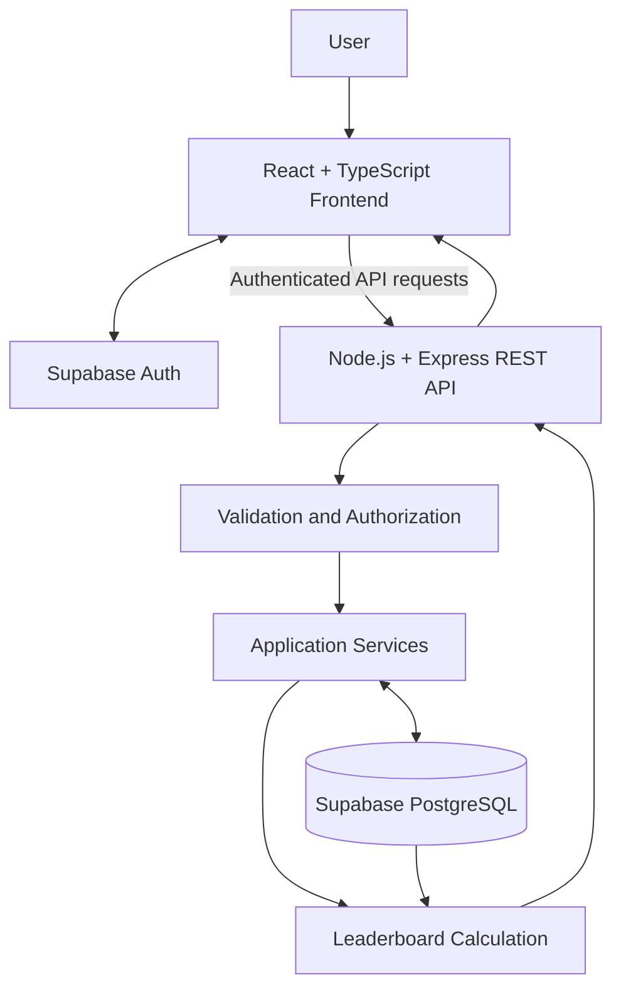

# ClusterHub — Gaming Tournament & Match Management System

<!-- OPTIONAL: Add this line after creating the banner file.
<div align="center">
  
</div>
-->

<div align="center">

**Organize tournaments. Manage matches. Track the competition.**

A focused full-stack platform for managing gaming tournaments, teams, registrations, match schedules, results, and leaderboards in one place.

<br>

<!-- Add these badges after the corresponding features have been verified. -->


<br>

[Project Specification](docs/PROJECT_SPEC.md) · [Architecture](docs/ARCHITECTURE.md) · [Database Schema](docs/DATABASE_SCHEMA.md) · [API Contract](docs/API_CONTRACT.md)

</div>

---

## The idea behind ClusterHub

Gaming tournaments involve more than selecting a game and starting a competition. Organizers need to maintain tournament details, coordinate teams, handle registrations, schedule matches, record results, and keep standings accurate.

When these activities are managed through separate spreadsheets, chat groups, and manually updated records, information becomes difficult to maintain. Participants may struggle to find reliable tournament information, while organizers spend time keeping different records synchronized.

**ClusterHub** brings the essential tournament-management workflow into one web application. It provides structured management for games, tournaments, and matches, with supporting team registrations and a leaderboard calculated from recorded results.

The goal is straightforward: make tournament administration more organized, accessible, and reliable without turning the project into an unnecessarily complex esports platform.

## The problem and the solution

| Common problem | ClusterHub's approach |
|---|---|
| Game information is scattered or duplicated | Maintain a centralized games catalogue. |
| Tournament details are difficult to keep updated | Create, view, edit, and delete tournament records. |
| Match schedules and results are managed manually | Maintain matches, participants, schedules, statuses, and results. |
| Team participation is difficult to track | Connect teams with tournaments through registrations. |
| Standings need to be recalculated manually | Derive leaderboard standings from saved match results. |
| Changes are not consistently reflected in records | Use a backend API and persistent database for application data. |
| Invalid or unauthorized changes can corrupt records | Validate inputs and enforce permissions on the server. |

## Core features

### 1. Games management

Maintain the catalogue of games supported by the platform.

- Create new game records.
- View game details and the games catalogue.
- Update existing game information.
- Delete games when permitted and when database relationships allow it.
- Validate required fields and display useful error messages.
- Connect games with their associated tournaments.

### 2. Tournaments management

Manage tournaments associated with supported games.

- Create tournaments with their relevant details.
- View tournament listings and individual details.
- Update tournament information.
- Delete tournaments subject to relationship and permission rules.
- Associate each tournament with a game.
- Maintain tournament information consistently in the database.

### 3. Matches management

Manage individual matches within tournaments.

- Schedule matches and assign participating teams where applicable.
- View match details, schedules, and statuses.
- Update match information.
- Record match results.
- Delete matches when permitted and appropriate.
- Use completed results as the source for leaderboard calculations.

These three modules are the primary CRUD requirements of the project. Each must support **Create, Read, Update, and Delete** operations with validation, clear feedback, and appropriate authorization.

### Supporting functionality

<details>
<summary><strong>Teams and registrations</strong></summary>

Maintain team records and connect eligible teams to tournaments through a simple registration workflow. Registration rules should prevent invalid or duplicate participation where applicable.

</details>

<details>
<summary><strong>Leaderboard</strong></summary>

Display standings calculated from recorded, completed match results. The leaderboard is derived data, not a separate ranking table that users manually edit. Scoring and tie-breaking rules should be documented and applied consistently.

</details>

<details>
<summary><strong>Authentication and authorization</strong></summary>

Use Supabase Auth for account identity and sessions. The backend must validate authenticated requests and enforce permissions for protected operations instead of relying only on hidden buttons or frontend route restrictions.

</details>

<details>
<summary><strong>Responsive interface and feedback</strong></summary>

Provide an interface that works across desktop, tablet, and mobile screen sizes, with form validation, loading states, success and error messages, and confirmation before destructive actions.

</details>

## MVP requirements checklist

The following table defines the intended minimum viable product. Implementation and testing status should be updated as each feature is completed.

| MVP requirement | Expected behavior | Verification |
|---|---|---|
| Games CRUD | Create, list, view, edit, and delete games | Test all four operations |
| Tournaments CRUD | Manage tournaments and their game associations | Test all four operations |
| Matches CRUD | Manage matches and record results | Test all four operations |
| Persistent storage | Save changes to Supabase PostgreSQL | Reload and verify persistence |
| Authentication | Sign in and maintain a valid session | Test valid and invalid sessions |
| Authorization | Restrict protected operations appropriately | Test allowed and denied requests |
| Teams and registrations | Maintain teams and tournament participation | Test registration rules |
| Leaderboard | Calculate standings from eligible saved results | Compare against known test results |
| Input validation | Reject missing or invalid data | Test invalid requests and forms |
| Delete confirmation | Confirm before destructive actions | Test cancellation and confirmation |
| API integration | Connect the frontend to the backend REST API | Verify successful and failed requests |
| Responsive UI | Support common screen sizes | Test desktop, tablet, and mobile |
| Deployment | Make the frontend and API accessible online | Verify deployed URLs and configuration |

**Important:** This is the target checklist, not a claim that all requirements have already been implemented or tested.

---

## How ClusterHub works

The application follows a straightforward workflow:

1. **Manage games:** create the games available for tournaments.
2. **Create tournaments:** associate tournaments with their respective games.
3. **Organize participation:** manage teams and registrations.
4. **Manage matches:** schedule matches and maintain their records.
5. **Record results:** save match outcomes through validated operations.
6. **View standings:** calculate leaderboard positions from eligible completed results.

## Architecture

ClusterHub separates the user interface, application logic, authentication, and persistent data.



### Frontend

The React and TypeScript frontend is responsible for rendering the interface, handling forms, displaying records, and communicating with the REST API. Supabase Auth supports the sign-in flow.

The existing frontend design should be preserved and integrated with real backend functionality rather than replaced unnecessarily.

### Backend

The Node.js and Express backend provides the REST API. It is responsible for request validation, business rules, permission checks, error handling, and database operations.

The backend must not report success when a database operation has failed.

### Database

Supabase PostgreSQL stores the application's persistent relational data. Relationships and constraints help keep records consistent across games, tournaments, teams, registrations, and matches.

Supabase Auth handles user identity. Database access policies and server-side authorization must be configured to protect data appropriately. <https://supabase.com/docs/guides/auth>

## Technology stack

| Layer | Technology | Purpose |
|---|---|---|
| Frontend | React | User interface and application screens |
| Language | TypeScript | Type-safe application development |
| Backend runtime | Node.js | Server-side JavaScript runtime |
| Backend framework | Express | REST API and request handling |
| Database | Supabase PostgreSQL | Persistent relational data |
| Authentication | Supabase Auth | User identity and sessions |
| API format | REST + JSON | Communication between frontend and backend |
| Version control | Git and GitHub | Source-code management |
| Frontend hosting | Netlify — planned | Frontend deployment |
| Backend hosting | Render — planned | Express API deployment |

Deployment providers and free-plan limits should be checked before deployment. The technology list describes the selected architecture; it does not imply that hosting has already been configured.

## Project structure

The following is the intended repository layout. Adjust the directory names to match the actual source files in the repository.

```text
ClusterHub/
├── README.md
├── .env.example
├── .gitignore
│
├── docs/
│   ├── PROJECT_SPEC.md
│   ├── ARCHITECTURE.md
│   ├── DATABASE_SCHEMA.md
│   ├── API_CONTRACT.md
│   ├── DEVELOPMENT_PLAN.md
│   ├── TESTING_AND_DEPLOYMENT.md
│   └── AI_WORKFLOW.md
│
├── frontend/
│   ├── package.json
│   ├── src/
│   └── ...
│
├── backend/
│   ├── package.json
│   ├── src/
│   └── ...
│
└── database/
    ├── README.md
    └── migrations/
        └── 0001_initial_schema.sql
```

The `frontend/` directory contains the React application, `backend/` contains the Express API, and `database/` contains database setup documentation and versioned migrations.

The exact contents depend on the current repository. Do not assume that every listed file exists until it has been checked.

## API overview

The Express API exposes the operations required by the frontend. The following paths illustrate the intended resource structure; the final endpoint names and request formats must match `docs/API_CONTRACT.md` and the implemented routes.

| Resource | Typical operations |
|---|---|
| Games | `GET`, `POST`, `GET /:id`, `PATCH` or `PUT /:id`, `DELETE /:id` |
| Tournaments | `GET`, `POST`, `GET /:id`, `PATCH` or `PUT /:id`, `DELETE /:id` |
| Matches | `GET`, `POST`, `GET /:id`, `PATCH` or `PUT /:id`, `DELETE /:id` |
| Teams | Create, list, view, update, and delete where permitted |
| Registrations | Create and manage registrations according to tournament rules |
| Leaderboard | Retrieve calculated standings for a tournament |

A typical resource endpoint might be `/api/v1/games`, but the API prefix and route names should be confirmed against the actual implementation.

All protected operations must verify authentication and authorization. Invalid requests should return meaningful HTTP status codes and structured error responses.

## Database and data integrity

The database should represent the relationships between the core entities rather than storing unrelated copies of the same information.

The main entities are expected to include:

- **Users** — account identity and application role information where required.
- **Games** — the games supported by the platform.
- **Tournaments** — tournaments linked to games.
- **Teams** — teams participating in tournaments.
- **Registrations** — the relationship between teams and tournaments.
- **Matches** — matches associated with tournaments and participating teams.

Match results should be stored in a consistent form that the leaderboard calculation can interpret. Invalid relationships, duplicate registrations, and inconsistent match states should be handled by the relevant validation and database rules.

Apply database migrations carefully to a development environment before production. Do not reset or drop existing data as a routine setup step.

## Security principles

ClusterHub should follow these basic security rules:

- Keep secret keys and database credentials out of source control.
- Never expose a Supabase secret or service-role key in frontend code.
- Validate input on the backend, even when the frontend already validates it.
- Verify authentication tokens and enforce permissions for protected API operations.
- Use database constraints and appropriate Row Level Security (RLS) policies where applicable.
- Configure CORS for the intended frontend origins.
- Avoid returning internal stack traces, credentials, or sensitive implementation details to users.
- Test unauthorized requests as well as successful requests.

See the official [Supabase documentation](https://supabase.com/docs/guides/database/connecting-to-postgres) for database connection guidance and the [Express production security guide](https://expressjs.com/en/advanced/best-practice-security.html) for additional security practices.

## Run it locally

### Prerequisites

Install the following before starting:

- Node.js and npm, using versions compatible with the project's package files.
- Git.
- A Supabase project.
- A code editor such as Visual Studio Code or Google Antigravity.
- The ClusterHub repository.

### 1. Get the source code

```bash
git clone <YOUR_GITHUB_REPOSITORY_URL>
cd ClusterHub
```

Replace the repository URL and directory name with the actual values for your project.

### 2. Configure Supabase

1. Create or select a development Supabase project.
2. Review the schema and migration files in `database/`.
3. Apply the appropriate migration to the development database.
4. Configure authentication and database access policies.
5. Obtain the project URL and the appropriate keys from the Supabase dashboard.

Do not run an unreviewed migration against a database containing important data.

### 3. Configure the backend

Open a terminal in the backend directory:

```bash
cd backend
npm install
```

Create a local `.env` file based on the backend's `.env.example`, if provided. Configure the variables expected by the implementation, such as:

```dotenv
PORT=4000
SUPABASE_URL=your_supabase_project_url
SUPABASE_SECRET_KEY=your_server_side_secret_key
```

These names are examples and must match the actual backend configuration. If the project uses a different server-side database access method or environment-variable names, follow its implementation.

Start the backend using the development script defined in `backend/package.json`. For example, if the project defines a `dev` script:

```bash
npm run dev
```

The API will typically be available at `http://localhost:4000` if the port is configured as shown above.

### 4. Configure the frontend

Open a separate terminal:

```bash
cd frontend
npm install
```

Create a local `.env` file using the frontend's environment-variable template. A Vite-based frontend using Supabase Auth may require:

```dotenv
VITE_API_BASE_URL=http://localhost:4000/api/v1
VITE_SUPABASE_URL=your_supabase_project_url
VITE_SUPABASE_PUBLISHABLE_KEY=your_supabase_publishable_key
```

Use the exact variable names expected by the application. Vite variables prefixed with `VITE_` are exposed to browser code, so they must never contain secret keys.

Start the frontend using the script defined in `frontend/package.json`. For a project with a `dev` script:

```bash
npm run dev
```

Open the local URL printed by the development server.

### 5. Verify the application

Before treating the setup as complete, confirm that:

- The frontend can reach the backend API.
- Authentication works with the configured Supabase project.
- Games, tournaments, and matches can be created and retrieved.
- Updates persist after reloading the application.
- Deletion follows the application's confirmation and relationship rules.
- Invalid data produces clear errors.
- Protected operations reject unauthorized requests.
- The leaderboard reflects saved match results.

## Testing and quality checks

The application should be tested at both the API and user-interface levels.

| Area | What to verify |
|---|---|
| Games | All CRUD operations, required fields, invalid IDs |
| Tournaments | CRUD operations and valid game relationships |
| Matches | CRUD operations, valid participants, result handling |
| Registrations | Eligibility, duplicate prevention, relationship integrity |
| Leaderboard | Correct calculation from eligible completed matches |
| Authentication | Sign-in, sign-out, invalid or expired sessions |
| Authorization | Access allowed only for permitted actions |
| Persistence | Saved changes remain after page reloads |
| Error handling | API failures and invalid requests display meaningful feedback |
| Responsive design | Navigation, tables, and forms on desktop and mobile |
| Deployment | Correct environment variables, API URL, CORS, and authentication redirects |

Run the test and build scripts actually defined in the project’s package files. Record which checks pass and fix failing checks before describing the application as tested.

## Deployment

The intended deployment arrangement is:

| Component | Planned provider |
|---|---|
| Frontend | Netlify |
| Backend REST API | Render |
| Database and authentication | Supabase |

A deployment should not be considered complete until the actual URLs are available and verified.

Before going live:

1. Apply and verify database migrations.
2. Configure backend environment variables in the hosting provider.
3. Configure the frontend's production API URL and public Supabase settings.
4. Set CORS to allow the deployed frontend origin.
5. Configure authentication redirect URLs in Supabase.
6. Verify all required CRUD operations against the deployed database.
7. Test authorization, error handling, and persistence.
8. Confirm the application works without relying on local development services.

Free hosting plans can have usage limits, sleeping services, and other restrictions. Confirm current provider conditions before relying on them for a demonstration.

## Current limitations and project boundaries

ClusterHub is intentionally scoped as a manageable Web Engineering project rather than a large commercial esports platform.

The agreed MVP does **not** require:

- Live game-server integrations.
- In-app payments or prize-money processing.
- Real-time voice or chat systems.
- Social networking feeds.
- Complex automated tournament-bracket generation.
- Advanced streaming integrations.
- A separate microservice for every feature.

The leaderboard should remain derived from recorded results, and supporting modules should stay simple enough to maintain the core CRUD requirements.

These are scope boundaries, not claims that the excluded features are implemented.

## Future improvements

Potential improvements after the core application is working include:

- Automated tournament brackets.
- Tournament announcements and email notifications.
- More detailed match statistics.
- Advanced filtering and tournament discovery.
- Additional organizer analytics.
- Expanded role and permission management.

Future work should be prioritized only after the core modules, persistence, security, and required testing are reliable.

## Project documentation

The repository's documentation should remain aligned with the implementation.

| Document | Purpose |
|---|---|
| [Project Specification](docs/PROJECT_SPEC.md) | Problem statement, scope, requirements, and exclusions |
| [Architecture](docs/ARCHITECTURE.md) | Application layers and data flow |
| [Database Schema](docs/DATABASE_SCHEMA.md) | Entities, relationships, constraints, and indexes |
| [API Contract](docs/API_CONTRACT.md) | Endpoints, request formats, responses, and errors |
| [Development Plan](docs/DEVELOPMENT_PLAN.md) | Implementation order and milestones |
| [Testing and Deployment](docs/TESTING_AND_DEPLOYMENT.md) | Verification strategy and release checklist |
| [AI Workflow](docs/AI_WORKFLOW.md) | Working conventions for AI-assisted development |

## A note on project status

ClusterHub's goal is to deliver a working, responsive, database-backed tournament management system—not just a set of static screens.

Features, test results, screenshots, and deployment links should be added here only when they reflect the actual repository and have been verified. Before submission, update the README with the real GitHub URL, confirmed live demo, screenshots, and evidence that all three primary CRUD modules work end to end.

---

<div align="center">

**ClusterHub**

*One platform. Better organized tournaments.*

Built as a Web Engineering project.

</div>
