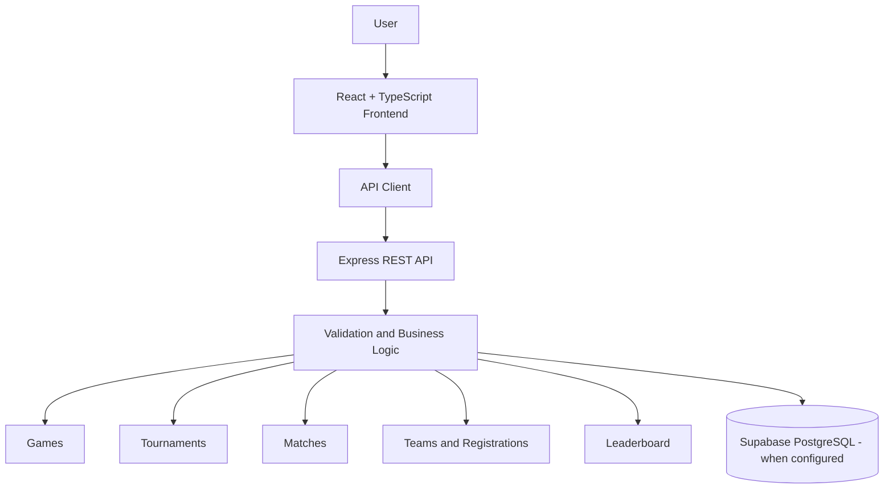

# 🎮 ClusterHub — Gaming Tournament & Match Management System

<div align="center">

**Organize tournaments. Manage matches. Track the competition.**

A full-stack gaming management platform designed to bring games, tournaments, teams, registrations, match schedules, and leaderboards together in one place.

<br>


<br>

[Repository](https://github.com/Ahad-Panhwer/ClusterHub) · [Source Code](https://github.com/Ahad-Panhwer/ClusterHub/tree/main) · [Report an Issue](https://github.com/Ahad-Panhwer/ClusterHub/issues)

</div>

---

## 📌 About the Project

Managing gaming tournaments involves coordinating games, teams, registrations, match schedules, results, and standings. Keeping this information organized across separate tools can make tournament administration unnecessarily complicated.

**ClusterHub** provides a centralized interface for managing these activities through a single web application.

The project combines a React-based frontend with TypeScript and an Express backend to support the core management workflows. Its interface includes a dashboard, dedicated management pages, authentication screens, and a leaderboard.

The application has been built and runs locally. **Online deployment is the remaining step.**

## 🎯 Problem & Solution

| Problem | ClusterHub solution |
|---|---|
| Game information is difficult to organize | Centralized games management |
| Tournament details require frequent updates | Dedicated tournament management |
| Match schedules and results can become confusing | Match scheduling and result management |
| Team participation is difficult to track | Teams and registrations management |
| Competition standings need to be calculated | Leaderboard based on match results |
| Information is spread across different screens and tools | One interface for essential tournament activities |

## ✨ Key Features

### 🎮 Games Management
- Create and manage game records.
- View the available games catalogue.
- Update game information.
- Delete game records.
- Maintain details such as genre, platform, description, and player limits.

### 🏆 Tournament Management
- Create and manage tournaments.
- Associate tournaments with games.
- Maintain tournament details, dates, formats, and status.
- Update tournament information.
- View tournament-related team registrations and matches.

### ⚔️ Match Management
- Schedule matches between teams.
- Maintain match rounds and schedules.
- Update match details and status.
- Record scores and results.
- Identify winners from completed matches.

### 👥 Teams Management
- Create and manage teams.
- Maintain team names, tags, and captain information.
- View and update team details.
- Connect teams with tournament participation.

### 📝 Registrations Management
- Register teams for tournaments.
- View tournament registrations.
- Update registration status.
- Prevent duplicate registrations through application-level validation.
- Support registration limits and waitlisting.

### 📊 Leaderboard
- Display team standings.
- Track matches played, wins, losses, points, and win rate.
- Calculate rankings from match results.
- View standings across competitions.

### 📈 Dashboard
- View a summary of games, tournaments, matches, and teams.
- Access key tournament information from one screen.
- Navigate quickly to the main management modules.

### 🔐 Authentication & Application Settings
- Dedicated authentication interface.
- Application-level authentication state management.
- Settings and application preferences.
- User-friendly notifications and feedback.

## 🛠️ Technology Stack

| Technology | Purpose |
|---|---|
| React | Frontend user interface |
| TypeScript | Type-safe application development |
| Vite | Frontend development and build tooling |
| Node.js | JavaScript runtime |
| Express.js | Backend server and REST API |
| Supabase | Optional PostgreSQL and authentication integration in the backend |
| React Router | Page navigation |
| Lucide React | Interface icons |
| Git & GitHub | Version control and source-code hosting |

## 🏗️ Project Architecture

ClusterHub separates its frontend interface from its backend API.



The frontend provides the interface and communicates with the API client. The Express backend exposes endpoints for managing the main resources and calculating leaderboard standings.

The backend supports an in-memory development mode when Supabase is not configured. Persistent database operation requires the appropriate Supabase configuration.

## 📂 Repository Structure

```text
ClusterHub/
├── README.md
├── package.json
├── .gitignore
│
├── Frontend_UI/
│   ├── package.json
│   ├── server.ts
│   ├── vite.config.ts
│   ├── netlify.toml
│   └── src/
│       ├── components/
│       ├── context/
│       ├── pages/
│       │   ├── AuthPage.tsx
│       │   ├── DashboardPage.tsx
│       │   ├── GamesPage.tsx
│       │   ├── TournamentsPage.tsx
│       │   ├── MatchesPage.tsx
│       │   ├── TeamsPage.tsx
│       │   ├── RegistrationsPage.tsx
│       │   ├── LeaderboardPage.tsx
│       │   └── SettingsPage.tsx
│       ├── services/
│       └── types/
│
└── GameTrack_Project/
    ├── README.md
    ├── .env.example
    ├── render.yaml
    ├── backend/
    │   ├── package.json
    │   ├── src/
    │   │   ├── config/
    │   │   ├── middleware/
    │   │   ├── repositories/
    │   │   ├── routes/
    │   │   ├── validators/
    │   │   ├── app.ts
    │   │   └── server.ts
    │   └── tests/
    ├── database/
    ├── docs/
    └── frontend/
```

## 💻 Run ClusterHub Locally

### Prerequisites

- Node.js and npm
- Git
- A code editor such as Visual Studio Code or Google Antigravity

### 1. Clone the repository

```bash
git clone https://github.com/Ahad-Panhwer/ClusterHub.git
cd ClusterHub
```

### 2. Install dependencies

Install the frontend and backend dependencies in their respective directories:

```bash
npm install --prefix Frontend_UI
npm install --prefix GameTrack_Project/backend
```

### 3. Configure the backend

Create a `.env` file inside `GameTrack_Project/backend/` and configure the required settings for your chosen operating mode.

For local development with Supabase, use the variable names supported by the backend:

```env
PORT=4000
NODE_ENV=development
FRONTEND_ORIGIN=http://localhost:3000
SUPABASE_URL=your_supabase_project_url
SUPABASE_ANON_KEY=your_supabase_anon_key
SUPABASE_SERVICE_ROLE_KEY=your_server_side_service_role_key
SUPABASE_JWT_SECRET=your_jwt_secret_if_required
```

Use your actual Supabase project settings and follow the repository's environment configuration. Do not commit real credentials or expose server-side secret keys in frontend code.

### 4. Configure the frontend

Create a local `.env.local` file inside `Frontend_UI/` if needed:

```env
VITE_API_BASE_URL=http://localhost:4000/api
```

If you use Supabase authentication in the frontend, configure the corresponding public Supabase settings as well. Follow `Frontend_UI/.env.example` for the supported variable names.

### 5. Start the backend

From the repository root:

```bash
npm run dev:backend
```

The backend's default development port is `4000`.

### 6. Start the frontend

Open another terminal at the repository root:

```bash
npm run dev:frontend
```

The frontend server defaults to port `3000`. Open the local address displayed in your terminal.

**Note:** The repository contains separate frontend and backend server implementations. Configure the frontend API URL to point to the backend instance you are actually running.

## 🚀 Deployment Status

ClusterHub is uploaded to GitHub and runs locally. Online hosting is still pending.

| Component | Deployment status |
|---|---|
| Source code | Available on GitHub |
| Frontend | Deployment pending |
| Backend API | Deployment pending |
| Production database configuration | To be verified for the hosted environment |
| Live application URL | Not available yet |

The repository contains a `netlify.toml` file for the frontend and a `render.yaml` file for the backend. These files can support deployment configuration, but the hosted services and their production settings still need to be configured and verified.

Once deployment is complete, add the actual live application URL to this README.

## 🔗 Project Links

- **GitHub Repository:** https://github.com/Ahad-Panhwer/ClusterHub
- **Issues & Feedback:** https://github.com/Ahad-Panhwer/ClusterHub/issues

---

<div align="center">

### ClusterHub

**One platform. Better organized tournaments.**

Built as a Web Engineering project.

</div>
