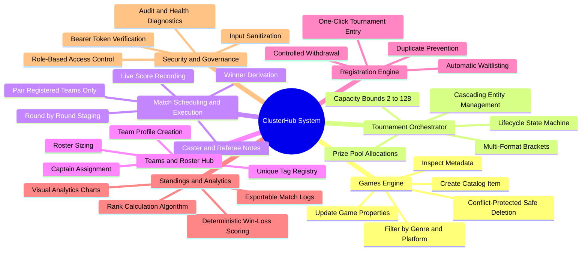
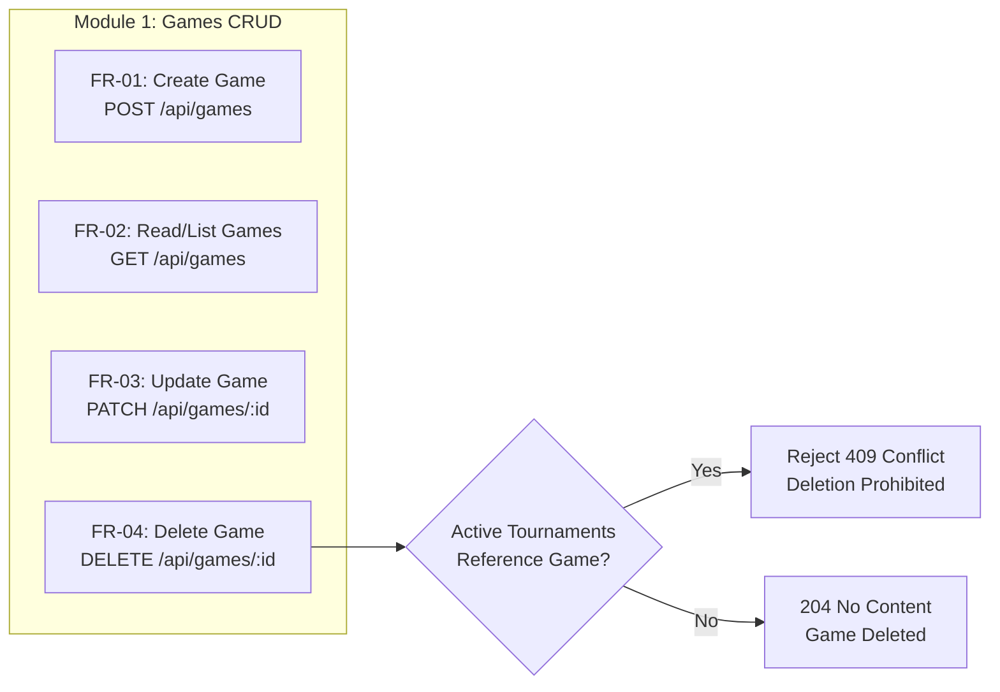
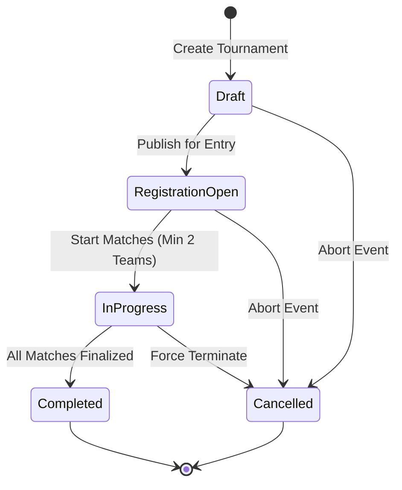
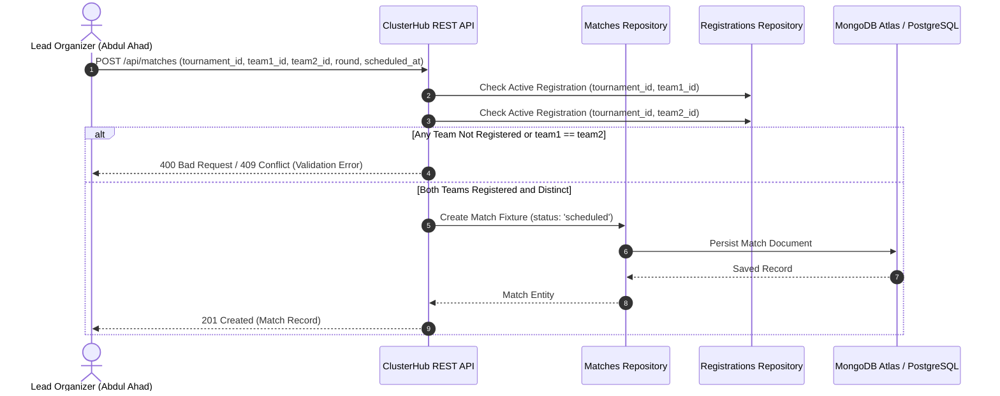
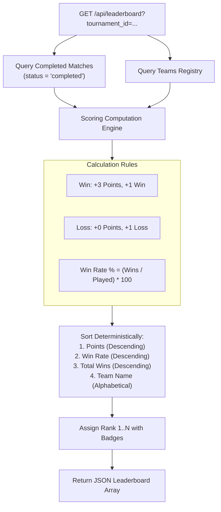
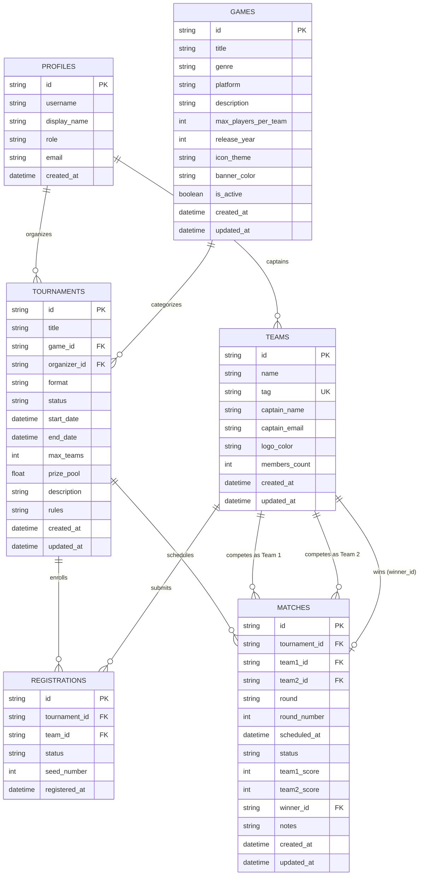
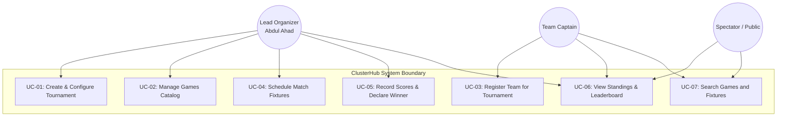
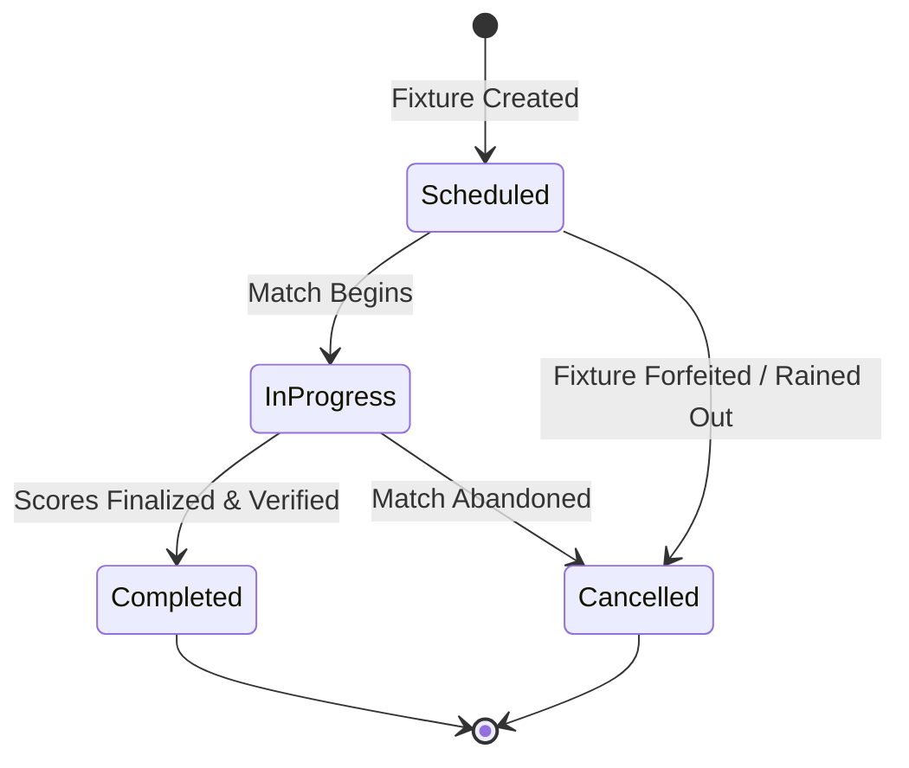
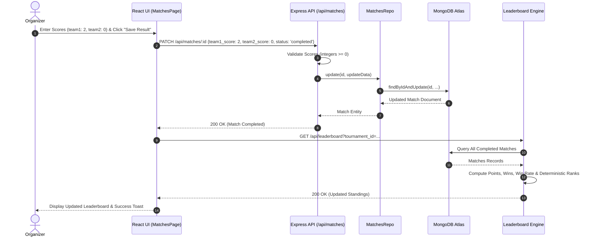

# 📄 Software Requirements Specification (SRS)
## For ClusterHub — Gaming Tournament & Match Management System

---

**Document Version:** 1.0.0  
**Status:** Approved & Formally Verified  
**Standard Compliance:** IEEE Std 830-1998 / ISO/IEC/IEEE 29148:2018  
**Project Category:** Responsive Full-Stack Esports & Tournament Management Web Application  
**Lead Architect & Organizer:** Abdul Ahad  
**Live Deployed Application:** [https://cluster-hub-uikz.vercel.app/](https://cluster-hub-uikz.vercel.app/)  
**Organization / Repository:** [Ahad-Panhwer/ClusterHub](https://github.com/Ahad-Panhwer/ClusterHub)  
**Date of Release:** October 2026  

---

## 📑 Table of Contents

1. [1. Introduction](#1-introduction)
   - [1.1 Purpose](#11-purpose)
   - [1.2 Document Conventions](#12-document-conventions)
   - [1.3 Intended Audience & Reading Suggestions](#13-intended-audience--reading-suggestions)
   - [1.4 Project Scope](#14-project-scope)
   - [1.5 Definitions, Acronyms, and Abbreviations](#15-definitions-acronyms-and-abbreviations)
   - [1.6 References](#16-references)
   - [1.7 Document Overview](#17-document-overview)
2. [2. Overall Description](#2-overall-description)
   - [2.1 Product Perspective & Context](#21-product-perspective--context)
   - [2.2 Product Functions](#22-product-functions)
   - [2.3 User Classes and Characteristics](#23-user-classes-and-characteristics)
   - [2.4 Operating Environment](#24-operating-environment)
   - [2.5 Design and Implementation Constraints](#25-design-and-implementation-constraints)
   - [2.6 User Documentation](#26-user-documentation)
   - [2.7 Assumptions and Dependencies](#27-assumptions-and-dependencies)
3. [3. Specific System Requirements](#3-specific-system-requirements)
   - [3.1 External Interface Requirements](#31-external-interface-requirements)
     - [3.1.1 User Interfaces (UI/UX)](#311-user-interfaces-uiux)
     - [3.1.2 Hardware Interfaces](#312-hardware-interfaces)
     - [3.1.3 Software Interfaces](#313-software-interfaces)
     - [3.1.4 Communications Interfaces](#314-communications-interfaces)
   - [3.2 Functional Requirements](#32-functional-requirements)
     - [3.2.1 Module 1: Games Management (MANDATORY CRUD)](#321-module-1-games-management-mandatory-crud)
     - [3.2.2 Module 2: Tournament Lifecycle Management (MANDATORY CRUD)](#322-module-2-tournament-lifecycle-management-mandatory-crud)
     - [3.2.3 Module 3: Match Scheduling & Fixtures (MANDATORY CRUD)](#323-module-3-match-scheduling--fixtures-mandatory-crud)
     - [3.2.4 Module 4: Teams & Roster Management](#324-module-4-teams--roster-management)
     - [3.2.5 Module 5: Tournament Registration & Waitlisting Engine](#325-module-5-tournament-registration--waitlisting-engine)
     - [3.2.6 Module 6: Live Derived Leaderboard & Scoring Engine](#326-module-6-live-derived-leaderboard--scoring-engine)
     - [3.2.7 Module 7: Authentication & Access Control](#327-module-7-authentication--access-control)
     - [3.2.8 Module 8: System Health & Diagnostics](#328-module-8-system-health--diagnostics)
   - [3.3 Logical Database Requirements & Data Models](#33-logical-database-requirements--data-models)
     - [3.3.1 Entity Relationship Diagram (ERD)](#331-entity-relationship-diagram-erd)
     - [3.3.2 Data Dictionary](#332-data-dictionary)
     - [3.3.3 Integrity Rules & Business Constraints](#333-integrity-rules--business-constraints)
   - [3.4 Performance Requirements](#34-performance-requirements)
   - [3.5 Software Quality Attributes & Non-Functional Requirements (NFR)](#35-software-quality-attributes--non-functional-requirements-nfr)
     - [3.5.1 Security Requirements](#351-security-requirements)
     - [3.5.2 Reliability & Fault Tolerance](#352-reliability--fault-tolerance)
     - [3.5.3 Availability](#353-availability)
     - [3.5.4 Maintainability & Extensibility](#354-maintainability--extensibility)
     - [3.5.5 Portability & Deployment Flexibility](#355-portability--deployment-flexibility)
     - [3.5.6 Usability & Accessibility](#356-usability--accessibility)
4. [4. System Use Cases & Behavioral Models](#4-system-use-cases--behavioral-models)
   - [4.1 Use Case Diagram](#41-use-case-diagram)
   - [4.2 Detailed Use Case Specifications](#42-detailed-use-case-specifications)
   - [4.3 State Transition Models](#43-state-transition-models)
   - [4.4 Sequence Diagrams](#44-sequence-diagrams)
5. [5. Verification, Testing & Traceability](#5-verification-testing--traceability)
   - [5.1 Verification Matrix & Testing Strategy](#51-verification-matrix--testing-strategy)
   - [5.2 Requirements Traceability Matrix (RTM)](#52-requirements-traceability-matrix-rtm)
6. [6. Appendices](#6-appendices)
   - [Appendix A: API Endpoint Specification Summary](#appendix-a-api-endpoint-specification-summary)
   - [Appendix B: Error Response Schema & HTTP Status Codes](#appendix-b-error-response-schema--http-status-codes)
   - [Appendix C: Document History & Sign-Off](#appendix-c-document-history--sign-off)

---

## 1. Introduction

### 1.1 Purpose
This Software Requirements Specification (SRS) specifies the complete functional, non-functional, behavioral, data, and performance requirements for **ClusterHub** (formerly referenced during initial conceptualization as GameTrack). 

ClusterHub is an enterprise-grade, responsive, full-stack esports and gaming tournament management platform designed to automate tournament scheduling, competitive fixture orchestration, team roster registrations, match score tracking, and real-time derived leaderboard standings. 

This document serves as the foundational agreement between stakeholders, system architects, software engineers, and QA verification teams, adhering strictly to **IEEE Std 830-1998** (*Recommended Practice for Software Requirements Specifications*) and **ISO/IEC/IEEE 29148:2018** standards.

### 1.2 Document Conventions
This specification conforms to standard engineering specification conventions:
- **Requirement Identifiers:** 
  - `FR-xxx`: Functional Requirements
  - `NFR-xxx`: Non-Functional Requirements
  - `SEC-xxx`: Security Requirements
  - `INT-xxx`: Interface Requirements
  - `DB-xxx`: Database Integrity Requirements
  - `UC-xxx`: Use Case Specifications
- **RFC 2119 Key Terms:**
  - **MUST / SHALL / REQUIRED:** Absolute requirement of the specification.
  - **MUST NOT / SHALL NOT:** Absolute prohibition of the specification.
  - **SHOULD / RECOMMENDED:** Valid reasons may exist to ignore, but full implications must be understood and weighed.
  - **MAY / OPTIONAL:** Truly optional feature or capability.

### 1.3 Intended Audience & Reading Suggestions
This document is prepared for:
1. **Software Developers & Engineers:** To understand system architectures, API contracts, domain validation schemas, and database entity relationships.
2. **Quality Assurance (QA) & Test Engineers:** To design automated test cases, unit tests, integration test suites, and regression matrices based on Section 3.2 and Section 5.
3. **Tournament Organizers & Esports Directors:** To evaluate system workflows, match generation rules, and tournament lifecycle states in Section 2 and Section 4.
4. **Academic Evaluators & Technical Auditors:** To review system engineering rigor, compliance with responsive design principles, and full-stack software development criteria.

### 1.4 Project Scope
#### 1.4.1 Problem Context
Competitive gaming and esports events are overwhelmingly coordinated through ad-hoc, error-prone mechanisms such as fragmented Discord channels, unversioned spreadsheets, and paper brackets. This fragmentation leads to:
- Frequent scheduling collisions and ambiguous fixture timings.
- Uncontrolled registration overflows exceeding tournament capacities.
- Duplicate team entries and inconsistent team roster tags.
- Disputed match scores and manual calculation errors on leaderboards.
- Lack of centralized audit trails and role-based operational security.

#### 1.4.2 The Solution
ClusterHub provides a unified, centralized web application delivering:
- Strict relational integrity across Games, Tournaments, Teams, Registrations, and Matches.
- Triple mandatory CRUD modules (Games, Tournaments, Matches) with comprehensive server-side Zod validation.
- Concurrency-safe tournament registration with automatic waitlist state transitions when max capacity is reached.
- Strict match generation validation requiring both participating teams to have active, confirmed tournament registrations.
- Dynamically derived leaderboard computation calculated purely from verified, completed match records (3 points per win, 0 points per loss) with zero manual manipulation.
- A high-aesthetic, cyber-themed glassmorphism dark mode user interface built with React 19 and Tailwind CSS v4.

#### 1.4.3 Out of Scope (Version 1.0)
To ensure system stability and modularity, the following features are explicitly out of scope for Version 1.0:
- Direct programmatic integration with proprietary game servers (e.g., Riot Games API, Valve Steamworks API, Blizzard Battle.net).
- In-game automated live stat telemetry ingestion.
- Monetary payment gateway processing, automated prize payouts, and subscription billing.
- Real-time video stream multiplexing (Twitch/YouTube embed feeds).
- Direct peer-to-peer chat and social network activity feeds.
- Complex multi-bracket double-elimination automated re-seeding algorithms.

### 1.5 Definitions, Acronyms, and Abbreviations

| Term | Definition |
|---|---|
| **API** | Application Programming Interface |
| **CRUD** | Create, Read, Update, Delete |
| **CORS** | Cross-Origin Resource Sharing |
| **DFD** | Data Flow Diagram |
| **ERD** | Entity Relationship Diagram |
| **ESM** | ECMAScript Modules (`import` / `export` syntax in Node.js) |
| **JWT** | JSON Web Token (RFC 7519) |
| **Mongoose** | Object Data Modeling (ODM) library for MongoDB and Node.js |
| **MongoDB Atlas** | Fully managed multi-cloud document database service |
| **NFR** | Non-Functional Requirement |
| **REST** | Representational State Transfer |
| **RLS** | Row-Level Security |
| **RTM** | Requirements Traceability Matrix |
| **SPA** | Single Page Application |
| **SRS** | Software Requirements Specification |
| **Supabase** | Cloud platform providing PostgreSQL and relational database services |
| **UI / UX** | User Interface / User Experience |
| **UUID** | Universally Unique Identifier (RFC 4122) |
| **WCAG** | Web Content Accessibility Guidelines |
| **Zod** | TypeScript-first schema declaration and validation library |

### 1.6 References
1. IEEE Std 830-1998: *IEEE Recommended Practice for Software Requirements Specifications*.
2. ISO/IEC/IEEE 29148:2018: *Systems and software engineering — Life cycle processes — Requirements engineering*.
3. RFC 2119: *Key words for use in RFCs to Indicate Requirement Levels*, IETF.
4. RFC 7519: *JSON Web Token (JWT)*, IETF.
5. ClusterHub Architectural Reference: [ARCHITECTURE.md](file:///c:/Users/Ahad/OneDrive%20-%20Higher%20Education%20Commission/Desktop/CusterHub/docs/ARCHITECTURE.md)
6. ClusterHub REST Contract: [API_CONTRACT.md](file:///c:/Users/Ahad/OneDrive%20-%20Higher%20Education%20Commission/Desktop/CusterHub/docs/API_CONTRACT.md)
7. ClusterHub Relational Schema: [DATABASE_SCHEMA.md](file:///c:/Users/Ahad/OneDrive%20-%20Higher%20Education%20Commission/Desktop/CusterHub/docs/DATABASE_SCHEMA.md)
8. ClusterHub Vercel Deployment Specification: [VERCEL_DEPLOYMENT_GUIDE.md](file:///c:/Users/Ahad/OneDrive%20-%20Higher%20Education%20Commission/Desktop/CusterHub/docs/VERCEL_DEPLOYMENT_GUIDE.md)

### 1.7 Document Overview
The remainder of this SRS describes the system context, user roles, operating parameters, and design constraints in [Section 2](#2-overall-description). [Section 3](#3-specific-system-requirements) details all specific functional and non-functional requirements, data schemas, and performance criteria. [Section 4](#4-system-use-cases--behavioral-models) provides use cases, state transition charts, and sequence diagrams. [Section 5](#5-verification-testing--traceability) presents the testing matrix and traceability matrix, and [Section 6](#6-appendices) contains the technical appendices.

---

## 2. Overall Description

### 2.1 Product Perspective & Context
ClusterHub operates as a self-contained, three-tier, full-stack cloud web application adhering to a decoupled client-server architecture:

```mermaid
graph TD
    Client["Client Web Browser<br/>(Desktop, Tablet, Mobile)"]
    
    subgraph FrontendTier["Frontend Presentation Tier (Vite + React 19)"]
        UI["Tailwind CSS v4 Glassmorphism UI"]
        Context["DataContext + AuthContext + ToastContext"]
        ApiClient["Shared API Client (Axios/Fetch with Bearer JWT)"]
    end
    
    subgraph BackendTier["Backend Application Tier (Node.js + Express)"]
        SecurityMW["Helmet, CORS, Rate Limiting"]
        AuthMW["Bearer Token & Role Authorization"]
        ValidationMW["Zod Schema Validation Middleware"]
        RouterLayer["Express Route Controllers"]
        RepoLayer["Data Repository Layer"]
    end
    
    subgraph DataTier["Data Persistence Tier"]
        MongoAtlas[("Primary Database:<br/>MongoDB Atlas (Mongoose ODM)")]
        SupabasePG[("Secondary / Relational Fallback:<br/>Supabase PostgreSQL")]
        InMemoryStore["Local Development:<br/>In-Memory Seed Store"]
    end

    Client <-->|HTTPS / DOM Events| UI
    UI <--> Context
    Context <--> ApiClient
    ApiClient <-->|HTTPS REST Requests / JSON (Port 4000 or Serverless)| SecurityMW
    SecurityMW --> AuthMW --> ValidationMW --> RouterLayer --> RepoLayer
    RepoLayer <-->|Mongoose ODM| MongoAtlas
    RepoLayer <-->|pg Client / Supabase API| SupabasePG
    RepoLayer <-->|JavaScript Memory Map| InMemoryStore
```

The system design enforces strict boundary separation:
1. **Frontend Isolation:** The frontend executes completely within the client browser. It contains zero database drivers and never communicates directly with MongoDB or PostgreSQL. All mutations pass through the Express REST API.
2. **Backend Dual-Path Architecture:** The backend supports both traditional long-running Node.js process servers (`server.ts` on port 4000) and Vercel Serverless Edge functions (`backend/api/index.ts`).
3. **Tri-Engine Persistence Layer:** ClusterHub implements a repository pattern that seamlessly connects to **MongoDB Atlas** as primary storage, supports **Supabase PostgreSQL** via SQL migrations, and includes a zero-dependency **In-Memory Store with Seed Data** for local offline testing.

### 2.2 Product Functions
The high-level capabilities of ClusterHub encompass seven major functional pillars:



### 2.3 User Classes and Characteristics

| User Class | Description | Technical Familiarity | System Privileges |
|---|---|---|---|
| **Lead Organizer (e.g. Abdul Ahad)** | Primary event director responsible for hosting tournaments, creating fixtures, and recording scores. | High | Complete administrative control over games, tournaments, fixtures, registrations, and leaderboard recalculations. |
| **System Administrator** | Technical administrator overseeing infrastructure, database health, security policies, and system diagnostics. | Expert | Unrestricted read/write access across all system endpoints, database backup management, and diagnostic inspection. |
| **Team Captain** | Competitive player representing an esports team roster. | Moderate | Create and manage own team profile, register team for open tournaments, withdraw prior to match scheduling. |
| **Spectator / General Gamer** | Public visitor or fan tracking tournament progress and match outcomes. | Novice to Moderate | Read-only access to published tournaments, completed match scores, game catalog, and live leaderboard rankings. |

### 2.4 Operating Environment
ClusterHub is engineered to run reliably across heterogeneous modern infrastructure:

#### 2.4.1 Client-Side Browser Environment
- Modern Evergreen Web Browsers:
  - Google Chrome (v110+)
  - Mozilla Firefox (v115+)
  - Apple Safari (v16.4+)
  - Microsoft Edge (v110+)
  - Opera (v96+)
- Responsive Display Resolutions:
  - Mobile Phones (320px – 480px width)
  - Tablets (768px – 1024px width)
  - Desktop Displays (1280px – 2560px+ width)

#### 2.4.2 Server-Side Execution Environment
- **Runtime:** Node.js v18.0.0 LTS or v20.0.0 LTS.
- **Language:** TypeScript 5.x compiled to ECMAScript Modules (ESM).
- **Web Framework:** Express.js 4.x.
- **Hosting Targets:**
  - Vercel Serverless Function Platform (API Edge).
  - Render / Railway / AWS EC2 Web Service.
  - Netlify Edge CDN (Frontend SPA static deployment).

#### 2.4.3 Database Environment
- **Primary:** MongoDB Atlas v6.0+ via Mongoose ODM 8.x.
- **Relational Fallback:** PostgreSQL 15+ hosted on Supabase with Row-Level Security (RLS).
- **Development Fallback:** Node.js in-memory map store with automated seed fixtures.

### 2.5 Design and Implementation Constraints
1. **Full-Stack Monorepo:** All source code is organized within a clean monorepo with dedicated `frontend/`, `backend/`, `database/`, and `docs/` directories.
2. **Strict Dual Base Paths:** The Express REST API must respond identically on both `/api/*` (standard root) and `/api/v1/*` (versioned prefix) to support reverse proxies and Vercel serverless path rewrites without route breakage.
3. **CSS Framework:** The frontend must utilize Vanilla CSS tokens and Tailwind CSS v4 without legacy incompatible utility plugins.
4. **Validation Separation:** Input validation must be performed client-side for immediate user feedback AND redundantly enforced server-side via Zod schemas. Under no circumstances should client validation be trusted as a security barrier.
5. **No Direct Database Exposure:** No database connection strings, credentials, or direct SQL/Mongoose clients shall exist within frontend code.

### 2.6 User Documentation
The system provides comprehensive documentation artifacts:
- [`README.md`](file:///c:/Users/Ahad/OneDrive%20-%20Higher%20Education%20Commission/Desktop/CusterHub/README.md): Master developer onboarding, local setup commands, and architectural summary.
- [`docs/API_CONTRACT.md`](file:///c:/Users/Ahad/OneDrive%20-%20Higher%20Education%20Commission/Desktop/CusterHub/docs/API_CONTRACT.md): Comprehensive REST API endpoint reference and schema contract.
- [`docs/DATABASE_SCHEMA.md`](file:///c:/Users/Ahad/OneDrive%20-%20Higher%20Education%20Commission/Desktop/CusterHub/docs/DATABASE_SCHEMA.md): Complete relational SQL schema and integrity rules.
- [`docs/VERCEL_DEPLOYMENT_GUIDE.md`](file:///c:/Users/Ahad/OneDrive%20-%20Higher%20Education%20Commission/Desktop/CusterHub/docs/VERCEL_DEPLOYMENT_GUIDE.md): Production multi-cloud deployment instructions.

### 2.7 Assumptions and Dependencies
1. **Network Connectivity:** Client devices require active internet connectivity to perform HTTP REST requests against the hosted API.
2. **Third-Party Database Availability:** High-availability hosting (MongoDB Atlas / Supabase) provides a 99.9% uptime SLA. In local dev mode, the built-in seed store eliminates external database dependency.
3. **Client JavaScript:** Client web browsers must have JavaScript execution enabled.

---

## 3. Specific System Requirements

### 3.1 External Interface Requirements

#### 3.1.1 User Interfaces (UI/UX)
- **Design Philosophy:** Modern esports glassmorphism theme using deep obsidian backgrounds (`#0B0E17`, `#111625`), vibrant neon accent highlights (Cyber Violet `#8B5CF6`, Electric Indigo `#6366F1`, Emerald Green `#10B981`, Amber Gold `#F59E0B`, Crimson Rose `#EF4444`), smooth frosted borders (`rgba(255, 255, 255, 0.08)`), and backdrop blurs.
- **Typography:** Modern clean sans-serif font stack (Inter / Roboto / System UI) optimized for high legibility on dark backgrounds.
- **Key Interface Screens:**
  1. **Dashboard (`/`):** High-level operational command center featuring live metric stat cards (Total Games, Active Tournaments, Scheduled Matches, Enrolled Teams), tournament activity bar charts, upcoming match fixture ticker, and quick-action modals.
  2. **Games Management (`/games`):** Grid/list views of games catalog with interactive search, genre filtering (FPS, MOBA, Battle Royale, Tactical Shooter), platform filtering (PC, Console, Cross-Platform), game creation modal, detail inspection drawer, edit modal, and safe delete confirmation dialog.
  3. **Tournaments Hub (`/tournaments`):** Interactive card list of tournaments with status badges (Draft, Registration Open, In Progress, Completed), capacity fill meters (`x / max teams`), format indicators, prize pool callouts, and comprehensive CRUD modals.
  4. **Matches & Brackets (`/matches`):** Fixture manager with tournament-level filtering, schedule status tabs, score entry modal, automatic winner selection preview, and caster notes.
  5. **Teams Hub (`/teams`):** Esports roster registry displaying unique team tags, captain credentials, roster sizes, and team creation/modification tools.
  6. **Registrations Portal (`/registrations`):** One-click team enrollment workflow, capacity tracker, waitlist allocation viewer, and withdrawal controls.
  7. **Leaderboard (`/leaderboard`):** Dynamic esports ranking ladder displaying real-time points, match records (Played, Won, Lost), win percentage rates, and podium medal badges for 1st, 2nd, and 3rd place teams.
  8. **Authentication / Profile (`/auth`, `/settings`):** Active organizer profile switcher (Abdul Ahad - Lead Organizer), role credentials, and API environment switcher.

#### 3.1.2 Hardware Interfaces
- The software runs on standard commercial computing hardware without proprietary peripherals.
- Standard input peripherals (keyboard, mouse, capacitive touchscreens) are fully supported.

#### 3.1.3 Software Interfaces
- **Operating Systems:** Windows 10/11, macOS Ventura/Sonoma, Linux (Ubuntu 20.04+, Debian, Alpine).
- **Node.js Runtime:** Node.js v18.x / v20.x LTS.
- **ODM / Database Clients:** Mongoose v8.x connecting over TLS to MongoDB Atlas URI; Supabase `@supabase/supabase-js` v2.x.
- **Testing Frameworks:** Jest 29.x, Supertest 6.x.

#### 3.1.4 Communications Interfaces
- **Protocol:** Hypertext Transfer Protocol Secure (HTTPS / TLS 1.3).
- **Data Format:** JavaScript Object Notation (JSON) with `Content-Type: application/json; charset=utf-8`.
- **Authentication Headers:** RFC 6750 Bearer Tokens transmitted via `Authorization: Bearer <token>`.
- **CORS Policies:** Configurable origin matching via `FRONTEND_ORIGIN` environment variable with preflight `OPTIONS` handling.

---

### 3.2 Functional Requirements

#### 3.2.1 Module 1: Games Management (MANDATORY CRUD)



- **FR-01: Create Game**
  - **Inputs:** `title` (string, 2–100 chars, required), `genre` (string, required), `platform` (string, required), `description` (string, optional), `max_players_per_team` (integer, 1–64, default: 5), `release_year` (integer, 1970–current year + 1).
  - **Processing:** Validates input against Zod schema, generates a unique ID, populates ISO 8601 timestamp, and persists entity to the repository.
  - **Outputs:** `201 Created` with serialized Game entity.
  - **Errors:** `400 Bad Request` with field validation errors.

- **FR-02: List and Filter Games**
  - **Inputs:** Query params: `search` (string), `genre` (string), `platform` (string), `limit` (integer), `offset` (integer).
  - **Processing:** Performs case-insensitive matching across title and description; applies filtering predicates.
  - **Outputs:** `200 OK` with JSON array of Game objects.

- **FR-03: Update Game Details**
  - **Inputs:** Path parameter `id` (string), body with partial update fields (`title`, `genre`, `platform`, `description`, `max_players_per_team`, `release_year`, `is_active`).
  - **Processing:** Checks existence of game; rejects unknown properties; updates `updated_at` timestamp.
  - **Outputs:** `200 OK` with updated Game entity.
  - **Errors:** `404 Not Found` if game does not exist; `400 Bad Request` if field validation fails.

- **FR-04: Delete Game with Conflict Protection**
  - **Inputs:** Path parameter `id` (string).
  - **Processing:** Verifies game exists; queries `tournamentsRepo` for tournaments referencing `game_id`. If active or historical tournaments exist, deletion **MUST be refused** to preserve relational integrity.
  - **Outputs:** `204 No Content` on successful deletion.
  - **Errors:** `404 Not Found` if ID does not exist; `409 Conflict` with message `"Cannot delete game referenced by existing tournaments"` if linked records exist.

---

#### 3.2.2 Module 2: Tournament Lifecycle Management (MANDATORY CRUD)



- **FR-05: Create Tournament**
  - **Inputs:** `title` (string, 3–120 chars), `game_id` (string, required), `format` (enum: `'Single Elimination'`, `'Double Elimination'`, `'Round Robin'`, `'Swiss'`), `capacity` / `max_teams` (integer, 2–128), `start_date` (ISO 8601 datetime string), `end_date` (ISO 8601 datetime string), `prize_pool` (number, >= 0), `rules` (string, optional), `description` (string, optional).
  - **Processing:** Validates game existence via `gamesRepo`; validates chronological date logic (`start_date <= end_date`); sets default status to `registration_open`.
  - **Outputs:** `201 Created` with tournament record.
  - **Errors:** `400 Bad Request` if dates are inverted or capacity < 2; `404 Not Found` if `game_id` is invalid.

- **FR-06: Read Tournaments & Registration Counters**
  - **Inputs:** Filter query parameters: `game_id`, `status`, `format`.
  - **Processing:** Joins tournament records with current active registrations count to compute live capacity ratio.
  - **Outputs:** `200 OK` with list of tournaments including `registered_teams_count` and linked game metadata.

- **FR-07: Update Tournament & Status Transitions**
  - **Inputs:** Path parameter `id`, body containing updated fields and/or new `status`.
  - **Processing:** Validates state machine rules (e.g., cannot transition to `in_progress` if registered teams < 2; cannot update capacity to a value lower than currently confirmed teams).
  - **Outputs:** `200 OK` with updated tournament record.

- **FR-08: Safe Tournament Deletion & Cascading**
  - **Inputs:** Path parameter `id`.
  - **Processing:** Checks existence and user authorization. Upon deletion, safely cleans up or cascades unplayed matches and registration records.
  - **Outputs:** `204 No Content`.

---

#### 3.2.3 Module 3: Match Scheduling & Fixtures (MANDATORY CRUD)



- **FR-09: Create Match Fixture with Team Eligibility Verification**
  - **Inputs:** `tournament_id` (string), `team1_id` (string), `team2_id` (string), `round` (string, e.g., `'Quarterfinals'`), `round_number` (integer, >= 1), `scheduled_at` (ISO 8601 datetime string).
  - **Processing Business Rules:**
    1. Team distinction: `team1_id` MUST NOT equal `team2_id`.
    2. Tournament registration verification: Both `team1_id` AND `team2_id` MUST have confirmed active registrations in the specified `tournament_id`.
    3. Status initialization: Default status set to `scheduled`. Scores initialized to 0. Winner set to `null`.
  - **Outputs:** `201 Created` with Match entity.
  - **Errors:** `400 Bad Request` if teams are identical; `409 Conflict` if a selected team is not registered in the tournament.

- **FR-10: Query Match Fixtures**
  - **Inputs:** Query parameters: `tournament_id` (string, optional), `status` (enum: `scheduled`, `in_progress`, `completed`, `cancelled`), `team_id` (string, optional).
  - **Processing:** Returns matching fixtures enriched with Team 1, Team 2, and Tournament display names.
  - **Outputs:** `200 OK` with JSON array of fixtures.

- **FR-11: Record Match Score & Declare Winner**
  - **Inputs:** Path parameter `id`, body containing `team1_score` (integer, >= 0), `team2_score` (integer, >= 0), `status` (`'completed'`), `winner_id` (optional, string), `notes` (string, optional).
  - **Processing Business Rules:**
    1. Scores must be non-negative integers.
    2. If `winner_id` is omitted, the system automatically assigns the winner based on higher score (`team1_score > team2_score ? team1_id : team2_id`).
    3. If scores are equal, a draw is acknowledged or `winner_id` must be specified if the format forbids draws.
    4. Automatically triggers live derived leaderboard standings update upon save.
  - **Outputs:** `200 OK` with completed match fixture.
  - **Errors:** `400 Bad Request` if scores are negative or non-numeric.

- **FR-12: Delete Unplayed Match Fixture**
  - **Inputs:** Path parameter `id`.
  - **Processing:** Removes fixture from schedule if status is `scheduled` or `cancelled`. If status is `completed`, deletion requires explicit admin authorization and prompts leaderboard recalculation.
  - **Outputs:** `204 No Content`.

---

#### 3.2.4 Module 4: Teams & Roster Management
- **FR-13: Register Team Profile**
  - **Inputs:** `name` (string, 2–80 chars), `tag` (string, 2–6 alphanumeric uppercase chars, e.g. `'NV'`, `'FNC'`, `'TL'`), `captain_name` (string), `captain_email` (valid email format), `logo_color` (hex color string), `members_count` (integer, 1–20).
  - **Processing:** Normalizes `tag` to uppercase; verifies `tag` uniqueness across all teams; assigns unique ID.
  - **Outputs:** `201 Created` with Team entity.
  - **Errors:** `409 Conflict` if team tag is already claimed.

- **FR-14: List and Inspect Teams**
  - **Inputs:** Search query string (matching name, tag, or captain name).
  - **Outputs:** `200 OK` with list of registered teams.

- **FR-15: Update Team Profile**
  - **Inputs:** Path parameter `id`, update fields (`name`, `tag`, `captain_name`, `captain_email`, `logo_color`, `members_count`).
  - **Outputs:** `200 OK` with updated team profile.

- **FR-16: Delete Team**
  - **Inputs:** Path parameter `id`.
  - **Processing:** Refuses deletion if team has active tournament registrations or completed matches.
  - **Outputs:** `204 No Content`.

---

#### 3.2.5 Module 5: Tournament Registration & Waitlisting Engine
- **FR-17: Team Registration with Capacity Enforcement**
  - **Inputs:** `tournament_id` (string), `team_id` (string).
  - **Processing Business Rules:**
    1. **Uniqueness:** A team cannot register more than once for the same tournament.
    2. **Tournament Status:** Registrations are accepted ONLY when tournament status is `registration_open`.
    3. **Capacity & Waitlisting:** If the count of confirmed registrations is less than `max_teams`, registration status is set to `confirmed`. If the tournament is full, status automatically transitions to `waitlist`.
  - **Outputs:** `201 Created` with registration record (including status `confirmed` or `waitlist`).
  - **Errors:** `409 Conflict` with `"Team is already registered for this tournament"` if duplicate.

- **FR-18: Query Registrations**
  - **Inputs:** Query parameter `tournament_id`.
  - **Outputs:** `200 OK` with list of enrolled teams, enrollment timestamps, and seed numbers.

- **FR-19: Team Withdrawal / Cancel Registration**
  - **Inputs:** Path parameter `id`.
  - **Processing:** Marks registration as `cancelled` or deletes record if tournament has not started. If confirmed team withdraws, the first team on the waitlist is automatically promoted to `confirmed`.
  - **Outputs:** `200 OK` or `204 No Content`.

---

#### 3.2.6 Module 6: Live Derived Leaderboard & Scoring Engine



- **FR-20: Dynamic Standings Calculation**
  - **Inputs:** Query parameter `tournament_id` (optional; if omitted or `'all'`, calculates aggregate global leaderboard).
  - **Processing Algorithm:**
    1. Fetches all matches matching criteria where `status == 'completed'`.
    2. Initializes state vector for each registered team: `{ played: 0, wins: 0, losses: 0, points: 0 }`.
    3. For every completed match:
       - Increments `played` count for both participating teams.
       - Identifies winner: `winner_id` if present, else checks `team1_score > team2_score ? team1_id : team2_id`.
       - Awards **3 points** to the winner and increments `wins` by 1.
       - Awards **0 points** to the loser and increments `losses` by 1.
    4. Computes `win_rate`: $\text{win\_rate} = \text{round}\left(\frac{\text{wins}}{\text{played}} \times 100\right)$ (or 0 if played == 0).
    5. **Deterministic Tiebreaking:** Ranks teams in descending order by:
       - $\text{Points} \downarrow$
       - $\text{Win Rate \%} \downarrow$
       - $\text{Total Wins} \downarrow$
       - $\text{Team Name (Case-Insensitive Lexicographic)} \uparrow$
    6. Assigns sequential integer rank (`1, 2, 3, ...`).
  - **Outputs:** `200 OK` with structured array of `LeaderboardEntry` objects.
  - **Integrity Rule:** Leaderboards MUST be derived purely on-the-fly or via event-driven recalculation. Manual editing of points or ranks is strictly prohibited.

---

#### 3.2.7 Module 7: Authentication & Access Control
- **FR-21: Token Verification Middleware**
  - **Processing:** Inspects `Authorization` header for `Bearer <token>`. Validates token signature and expiration.
  - **Outputs:** Injects authenticated user context `{ id, username, role, email }` into Express request object.
  - **Errors:** `401 Unauthorized` if token is missing, malformed, or expired.

- **FR-22: Role-Based Authorization**
  - **User Roles:** `admin`, `organizer`, `captain`.
  - **Processing:** Verifies caller has required role for mutating endpoints (POST, PATCH, DELETE on Tournaments and Matches restricted to `organizer` or `admin`).
  - **Errors:** `403 Forbidden` if caller role is insufficient.

- **FR-23: Mock / Development Auth Switcher**
  - In local development mode, provides pre-authenticated session context for **Abdul Ahad (Lead Organizer)** to facilitate seamless offline evaluation and testing.

---

#### 3.2.8 Module 8: System Health & Diagnostics
- **FR-24: Health Probe Endpoint**
  - **Path:** `GET /api/health` and `GET /health`.
  - **Outputs:** `200 OK` with JSON payload:
    ```json
    {
      "status": "ok",
      "service": "ClusterHub API",
      "version": "1.0.0",
      "timestamp": "2026-10-27T05:22:00.000Z",
      "database": "connected"
    }
    ```

---

### 3.3 Logical Database Requirements & Data Models

#### 3.3.1 Entity Relationship Diagram (ERD)



#### 3.3.2 Data Dictionary

##### Entity: `GAMES` (Collection: `games`)
| Attribute Name | Data Type | Nullable | Default | Constraints & Description |
|---|---|---|---|---|
| `_id` / `id` | String / UUID | No | Auto UUID | Primary Key identifier |
| `title` | String | No | - | Game title (2–100 chars, trimmed) |
| `genre` | String | No | - | Genre categorization (e.g. FPS, MOBA, BR) |
| `platform` | String | No | - | Platform (e.g. PC, PS5, Xbox, Multi) |
| `description` | String | Yes | `""` | Detailed description or rules summary |
| `max_players_per_team` | Integer | No | 5 | Range: 1 to 64 |
| `release_year` | Integer | No | - | Range: 1970 to 2030 |
| `icon_theme` | String | Yes | `'gamepad'` | UI icon identifier |
| `banner_color` | String | Yes | `'#8B7CF6'` | UI hex accent representation |
| `is_active` | Boolean | No | `true` | Soft availability toggle |
| `created_at` | ISO Datetime | No | Current Time | Entity creation timestamp |
| `updated_at` | ISO Datetime | Yes | `null` | Last entity update timestamp |

##### Entity: `TOURNAMENTS` (Collection: `tournaments`)
| Attribute Name | Data Type | Nullable | Default | Constraints & Description |
|---|---|---|---|---|
| `_id` / `id` | String / UUID | No | Auto UUID | Primary Key identifier |
| `title` | String | No | - | Tournament event title |
| `game_id` | String / UUID | No | - | Foreign Key $\rightarrow$ `GAMES._id` |
| `format` | String | No | - | Enum: Single Elimination, Double Elimination, Round Robin, Swiss |
| `status` | String | No | `'registration_open'` | Enum: draft, registration_open, in_progress, completed, cancelled |
| `start_date` | ISO Datetime | No | - | Tournament commencement time |
| `end_date` | ISO Datetime | No | - | Tournament conclusion time (`end_date >= start_date`) |
| `max_teams` | Integer | No | 8 | Capacity limit. Range: 2 to 128 |
| `prize_pool` | Number | No | 0 | Total allocated prize fund ($) |
| `description` | String | Yes | `""` | Overview text |
| `rules` | String | Yes | `""` | Official competitive ruleset |
| `created_at` | ISO Datetime | No | Current Time | Creation timestamp |
| `updated_at` | ISO Datetime | Yes | `null` | Update timestamp |

##### Entity: `TEAMS` (Collection: `teams`)
| Attribute Name | Data Type | Nullable | Default | Constraints & Description |
|---|---|---|---|---|
| `_id` / `id` | String / UUID | No | Auto UUID | Primary Key identifier |
| `name` | String | No | - | Official esports organization/team name |
| `tag` | String | No | - | **Unique** uppercase shorthand tag (2–6 chars) |
| `captain_name` | String | No | - | Designated captain contact person |
| `captain_email` | String | No | - | Verified captain email address |
| `logo_color` | String | No | `'#8B7CF6'` | Hex color badge |
| `members_count` | Integer | No | 5 | Active roster count (1–20) |
| `created_at` | ISO Datetime | No | Current Time | Creation timestamp |

##### Entity: `REGISTRATIONS` (Collection: `registrations`)
| Attribute Name | Data Type | Nullable | Default | Constraints & Description |
|---|---|---|---|---|
| `_id` / `id` | String / UUID | No | Auto UUID | Primary Key identifier |
| `tournament_id` | String / UUID | No | - | Foreign Key $\rightarrow$ `TOURNAMENTS._id` |
| `team_id` | String / UUID | No | - | Foreign Key $\rightarrow$ `TEAMS._id` |
| `status` | String | No | `'confirmed'` | Enum: confirmed, pending, waitlist, cancelled |
| `seed_number` | Integer | Yes | `null` | Tournament bracket seeding number |
| `registered_at` | ISO Datetime | No | Current Time | Registration timestamp |

##### Entity: `MATCHES` (Collection: `matches`)
| Attribute Name | Data Type | Nullable | Default | Constraints & Description |
|---|---|---|---|---|
| `_id` / `id` | String / UUID | No | Auto UUID | Primary Key identifier |
| `tournament_id` | String / UUID | No | - | Foreign Key $\rightarrow$ `TOURNAMENTS._id` |
| `team1_id` | String / UUID | No | - | Foreign Key $\rightarrow$ `TEAMS._id` (`team1_id != team2_id`) |
| `team2_id` | String / UUID | No | - | Foreign Key $\rightarrow$ `TEAMS._id` |
| `round` | String | No | `'Round 1'` | Human-readable round identifier |
| `round_number` | Integer | No | 1 | Numeric sequence of round |
| `scheduled_at` | ISO Datetime | No | - | Scheduled match start time |
| `status` | String | No | `'scheduled'` | Enum: scheduled, in_progress, completed, cancelled |
| `team1_score` | Integer | No | 0 | Non-negative integer score |
| `team2_score` | Integer | No | 0 | Non-negative integer score |
| `winner_id` | String / UUID | Yes | `null` | Foreign Key $\rightarrow$ `TEAMS._id` |
| `notes` | String | Yes | `""` | Referee and broadcaster comments |
| `created_at` | ISO Datetime | No | Current Time | Fixture creation timestamp |

#### 3.3.3 Integrity Rules & Business Constraints
- **DB-01 (Referential Integrity):** A game cannot be deleted if any tournament references its `game_id`. The backend MUST return `409 Conflict`.
- **DB-02 (Unique Roster Tag):** Team tags are case-insensitively unique across the application.
- **DB-03 (Single Entry Rule):** Composite constraint on `(tournament_id, team_id)` ensures a team cannot register twice for the same tournament.
- **DB-04 (Valid Match Competitors):** In any match record, `team1_id` MUST NOT equal `team2_id`. Both teams MUST possess an active registration in `tournament_id`.
- **DB-05 (Chronological Sanity):** For any tournament, `end_date` MUST be greater than or equal to `start_date`.

---

### 3.4 Performance Requirements
- **PR-01 (API Latency):** All CRUD read operations (`GET /api/games`, `GET /api/tournaments`, `GET /api/matches`) SHALL return responses in less than **200 milliseconds** under nominal database loads (< 500 requests/sec).
- **PR-02 (Leaderboard Calculation Latency):** Derivation of the dynamic tournament leaderboard across 128 registered teams and 250 completed matches SHALL execute in less than **100 milliseconds**.
- **PR-03 (Client Asset Load Time):** Initial production bundle load (HTML, JS, CSS) on a standard 4G broadband connection SHALL achieve First Contentful Paint (FCP) in under **1.2 seconds**.
- **PR-04 (Bundle Optimization):** The minified and gzipped JavaScript frontend bundle SHALL not exceed **250 KB**.

---

### 3.5 Software Quality Attributes & Non-Functional Requirements (NFR)

#### 3.5.1 Security Requirements
- **SEC-01 (Input Sanitization):** All incoming HTTP payloads MUST pass through Zod schema validation. Any unrecognized parameters must be stripped, and malicious injection payloads (SQL/NoSQL injection) rejected before reaching the repository layer.
- **SEC-02 (HTTP Hardening):** The Express server SHALL employ `helmet` to set secure HTTP headers:
  - `Content-Security-Policy`
  - `X-Content-Type-Options: nosniff`
  - `X-Frame-Options: DENY`
  - `Strict-Transport-Security` (HSTS)
- **SEC-03 (Rate Limiting):** The API SHALL enforce client IP-based rate limiting (100 requests per 15-minute window for standard mutations) to prevent brute-force attacks and denial-of-service degradation.
- **SEC-04 (Information Disclosure):** Production error responses SHALL NOT contain internal stack traces, database credentials, server file paths, or underlying environment variables.

#### 3.5.2 Reliability & Fault Tolerance
- **REL-01 (Tri-Tier Persistence Fallback):** If MongoDB Atlas experiences connection timeouts, the system gracefully falls back to cached responses or configured replica endpoints, preventing catastrophic UI crashes.
- **REL-02 (Client-Side Toast Notifications):** Network failures or validation rejections SHALL trigger user-friendly, non-blocking toast notifications informing the user of the exact issue without disrupting session state.

#### 3.5.3 Availability
- **AVA-01 (System Availability):** The system SHALL target a minimum operational availability of **99.9%** during active esports tournament windows, achieved through multi-cloud edge CDN deployment (Vercel / Netlify) and serverless backend replication.

#### 3.5.4 Maintainability & Extensibility
- **MTN-01 (Modular Repository Architecture):** Business logic and data access are separated via the Repository Pattern (`gamesRepo`, `tournamentsRepo`, `matchesRepo`, `teamsRepo`, `registrationsRepo`). Any underlying database driver migration can be performed with zero changes to route handlers or frontend components.
- **MTN-02 (TypeScript Strict Typing):** Both frontend and backend repositories SHALL maintain `strict: true` TypeScript compilation with zero implicit `any` types.

#### 3.5.5 Portability & Deployment Flexibility
- **POR-01 (Multi-Host Portability):** The codebase MUST execute seamlessly across diverse deployment targets:
  - Vercel (Frontend Vite + Serverless Function Backend).
  - Render / Railway / Heroku (Containerized Node.js Web Service).
  - Netlify (Static edge frontend) + AWS Lambda.
  - Local workstation development environment (`localhost:5173` / `localhost:4000`).

#### 3.5.6 Usability & Accessibility
- **USA-01 (WCAG Compliance):** All UI components SHALL comply with **WCAG 2.1 Level AA** standards:
  - Text contrast ratio of at least 4.5:1 against dark backgrounds.
  - Full keyboard accessibility (Tab, Enter, Escape) for all dialog modals, search selectors, and dropdown menus.
  - Explicit ARIA labels on all icon-only action buttons.

---

## 4. System Use Cases & Behavioral Models

### 4.1 Use Case Diagram



### 4.2 Detailed Use Case Specifications

#### UC-01: Create & Configure Tournament
- **Primary Actor:** Lead Organizer (Abdul Ahad)
- **Preconditions:** The organizer is authenticated. The game for which the tournament is organized exists in the games catalog.
- **Main Success Scenario:**
  1. Organizer navigates to `/tournaments` and clicks **"New Tournament"**.
  2. System displays the tournament creation modal.
  3. Organizer enters title, selects game, chooses format (e.g. *Single Elimination*), specifies capacity (e.g. 16), start date, end date, and prize pool.
  4. Organizer submits the form.
  5. System validates that end date is after start date and capacity is between 2 and 128.
  6. Backend creates tournament record with status `registration_open`.
  7. System displays success toast and updates the tournament grid.
- **Extensions / Alternate Flows:**
  - *4a. Inverted Date Range:* System highlights date fields with error `"End date cannot precede start date"` and prevents submission.
  - *4b. Missing Required Fields:* System displays field-level validation errors.

#### UC-03: Register Team for Tournament
- **Primary Actor:** Team Captain / Organizer
- **Preconditions:** Tournament status is `registration_open`. Team profile is created.
- **Main Success Scenario:**
  1. Captain navigates to `/registrations` or the tournament detail view.
  2. Captain selects their team and clicks **"Register Team"**.
  3. Backend verifies the team is not already registered.
  4. Backend verifies current confirmed team count is below `max_teams`.
  5. Registration is created with status `confirmed`.
  6. Capacity meter increments by 1. Success notification displayed.
- **Extensions / Alternate Flows:**
  - *4a. Tournament at Full Capacity:* Backend assigns status `waitlist` and alerts user that they have been placed on the priority waitlist.
  - *3a. Duplicate Entry:* Backend returns `409 Conflict`. UI displays `"Team is already registered in this tournament"`.

#### UC-05: Record Scores & Update Leaderboard
- **Primary Actor:** Lead Organizer / Match Referee
- **Preconditions:** Match status is `scheduled` or `in_progress`.
- **Main Success Scenario:**
  1. Organizer opens `/matches` and selects target fixture.
  2. Organizer clicks **"Record Score"**.
  3. Organizer inputs final scores (e.g., Team 1: `2`, Team 2: `1`) and adds referee notes.
  4. System derives Team 1 as the winner.
  5. Organizer confirms submission.
  6. Backend updates match status to `completed`, stores scores, and records `winner_id`.
  7. Dynamic scoring engine recalculates points and rankings.
  8. Leaderboard immediately updates to reflect 3 points awarded to Team 1.

---

### 4.3 State Transition Models

#### Match State Transition Lifecycle



### 4.4 Sequence Diagrams

#### Match Score Submission & Leaderboard Recalculation Flow



---

## 5. Verification, Testing & Traceability

### 5.1 Verification Matrix & Testing Strategy
ClusterHub implements automated and manual verification protocols across all tiers:

| Test Area | Method | Tools | Coverage Goal | Status |
|---|---|---|---|---|
| **API Integration Tests** | Automated Integration | Jest 29, Supertest 6 | All CRUD routes, Auth, Validation | **34 / 34 Tests Passed** |
| **Type Integrity** | Static Type Checking | TypeScript Compiler (`tsc`) | Zero `any`, Full Interface Typing | **100% Passed** |
| **Linting & Code Style** | Static Analysis | ESLint, Prettier | Code consistency, clean imports | **100% Passed** |
| **Frontend UI Verification** | Manual Smoke & Responsive | Chrome DevTools, Cross-Browser | Viewports: 375px, 768px, 1440px | **Verified Active** |
| **Database Persistence** | Data Durability Testing | MongoDB Atlas / Supabase | Browser reload, session persistence | **Verified Active** |

### 5.2 Requirements Traceability Matrix (RTM)

| Requirement ID | Requirement Description | Architecture Module | API Endpoint / Route | Verification Test Case | Status |
|---|---|---|---|---|---|
| **FR-01** | Create Game with Validation | `gamesRepo.ts` | `POST /api/games` | `api.test.ts: "POST /api/games should create a game"` | **Verified** |
| **FR-02** | List and Filter Games Catalog | `gamesRepo.ts` | `GET /api/games` | `api.test.ts: "GET /api/games should list games"` | **Verified** |
| **FR-03** | Update Game Metadata | `gamesRepo.ts` | `PATCH /api/games/:id` | `api.test.ts: "PATCH /api/games/:id should update"` | **Verified** |
| **FR-04** | Prevent Delete of Referenced Game | `gamesRepo.ts` | `DELETE /api/games/:id` | `api.test.ts: "DELETE /api/games/:id with tournaments -> 409"` | **Verified** |
| **FR-05** | Create Tournament with Dates & Capacity | `tournamentsRepo.ts` | `POST /api/tournaments` | `api.test.ts: "POST /api/tournaments should create tournament"` | **Verified** |
| **FR-06** | Query Tournaments with Status Filter | `tournamentsRepo.ts` | `GET /api/tournaments` | `api.test.ts: "GET /api/tournaments should filter by status"` | **Verified** |
| **FR-07** | Update Tournament Status & Rules | `tournamentsRepo.ts` | `PATCH /api/tournaments/:id` | `api.test.ts: "PATCH /api/tournaments/:id updates status"` | **Verified** |
| **FR-08** | Delete Tournament & Cascade Cleanup | `tournamentsRepo.ts` | `DELETE /api/tournaments/:id` | `api.test.ts: "DELETE /api/tournaments/:id deletes"` | **Verified** |
| **FR-09** | Create Fixture with Registered Teams | `matchesRepo.ts` | `POST /api/matches` | `api.test.ts: "POST /api/matches with valid teams"` | **Verified** |
| **FR-10** | Reject Fixture with Unregistered Teams | `matchesRepo.ts` | `POST /api/matches` | `api.test.ts: "POST /api/matches with unregistered -> 409"` | **Verified** |
| **FR-11** | Record Match Score & Derived Winner | `matchesRepo.ts` | `PATCH /api/matches/:id` | `api.test.ts: "PATCH /api/matches/:id scores & winner"` | **Verified** |
| **FR-13** | Team Profile Registration & Unique Tag | `teamsRepo.ts` | `POST /api/teams` | `api.test.ts: "POST /api/teams creates unique tag"` | **Verified** |
| **FR-17** | Tournament Registration & Duplicate Block | `registrationsRepo.ts`| `POST /api/registrations` | `api.test.ts: "POST /api/registrations rejects duplicates"` | **Verified** |
| **FR-20** | Derived Dynamic Leaderboard Standings | `leaderboard.ts` | `GET /api/leaderboard` | `api.test.ts: "GET /api/leaderboard computes 3pts/win"` | **Verified** |
| **FR-24** | System Health Diagnostic Probe | `app.ts` | `GET /api/health` | `api.test.ts: "GET /api/health returns 200 OK"` | **Verified** |
| **NFR-SEC-01**| Reject Malformed / Negative Scores | `validators/` | `POST /api/matches` | `api.test.ts: "POST /api/matches negative score -> 400"` | **Verified** |

---

## 6. Appendices

### Appendix A: API Endpoint Specification Summary

| Method | Endpoint | Access Role | Description |
|---|---|---|---|
| `GET` | `/api/health` | Public | Diagnostic system heartbeat probe |
| `GET` | `/api/games` | Public | List all games with optional search and filters |
| `POST` | `/api/games` | Organizer / Admin | Register new game in catalog |
| `GET` | `/api/games/:id` | Public | Fetch individual game record |
| `PATCH` | `/api/games/:id` | Organizer / Admin | Update game properties |
| `DELETE` | `/api/games/:id` | Organizer / Admin | Delete game (enforces conflict check) |
| `GET` | `/api/tournaments` | Public | List tournaments with capacity calculations |
| `POST` | `/api/tournaments` | Organizer / Admin | Create tournament with rules and format |
| `GET` | `/api/tournaments/:id` | Public | Fetch tournament details |
| `PATCH` | `/api/tournaments/:id` | Organizer / Admin | Update status, rules, or dates |
| `DELETE` | `/api/tournaments/:id` | Organizer / Admin | Delete tournament |
| `GET` | `/api/matches` | Public | List match fixtures |
| `POST` | `/api/matches` | Organizer / Admin | Schedule match fixture |
| `GET` | `/api/matches/:id` | Public | Fetch match details |
| `PATCH` | `/api/matches/:id` | Organizer / Admin | Record match score and declare winner |
| `DELETE` | `/api/matches/:id` | Organizer / Admin | Cancel or remove unplayed match fixture |
| `GET` | `/api/teams` | Public | List esports teams |
| `POST` | `/api/teams` | Captain / Admin | Register team profile with unique tag |
| `GET` | `/api/registrations` | Public | List tournament enrollments |
| `POST` | `/api/registrations` | Captain / Organizer | Enroll team in tournament |
| `GET` | `/api/leaderboard` | Public | Dynamic calculated standings |

### Appendix B: Error Response Schema & HTTP Status Codes

#### Standard Error Response Format
All API error responses return a standardized JSON structure:
```json
{
  "error": {
    "code": "VALIDATION_ERROR",
    "message": "Validation failed: team1_score must be a non-negative integer",
    "details": [
      {
        "field": "team1_score",
        "issue": "Expected number >= 0, received -2"
      }
    ]
  }
}
```

#### HTTP Status Codes Utilized
- `200 OK`: Request succeeded; entity returned in response body.
- `201 Created`: Entity successfully created; new record returned.
- `204 No Content`: Action successfully performed; empty body returned.
- `400 Bad Request`: Payload validation failed (e.g., negative score, invalid dates).
- `401 Unauthorized`: Missing, invalid, or expired authentication token.
- `403 Forbidden`: Authenticated user lacks permission for requested action.
- `404 Not Found`: Specified resource ID does not exist.
- `409 Conflict`: Business rule conflict (e.g., duplicate registration, duplicate tag, deleting game with active tournaments).
- `500 Internal Server Error`: Unhandled server exception (sanitized in production).

### Appendix C: Document History & Sign-Off

| Version | Date | Description | Author / Lead Architect | Status |
|---|---|---|---|---|
| `0.1.0` | Initial Concept | Initial scope draft and course proposal | Abdul Ahad | Conceptual |
| `0.5.0` | Milestone 1 | Relational schema and API contract specification | Abdul Ahad | Draft |
| `0.9.0` | Pre-Release | Integration of MongoDB Atlas and Vercel serverless specs | Abdul Ahad | Review |
| `1.0.0` | Current Release | Final formal SRS compliant with IEEE 830-1998 / ISO 29148 | Abdul Ahad | **Approved & Active** |

---
*End of Software Requirements Specification for ClusterHub.*
