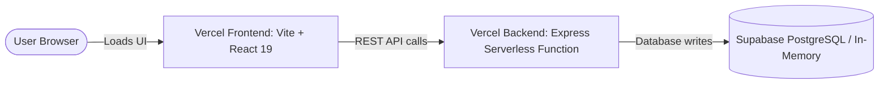

# 🚀 ClusterHub — Vercel Deployment Guide

Complete step-by-step guide to hosting **ClusterHub (React Frontend + Express Backend)** on **[Vercel](https://vercel.com/)**.

---

## 📌 Architecture Overview on Vercel

Because Vercel is a modern serverless edge platform:
- The **Frontend** (`frontend/`) is compiled into optimized static HTML/JS/CSS assets with automatic edge CDN caching.
- The **Backend** (`backend/`) is executed as a high-performance **Vercel Serverless Function** via [`backend/api/index.ts`](file:///c:/Users/Ahad/OneDrive%20-%20Higher%20Education%20Commission/Desktop/CusterHub/backend/api/index.ts) and [`backend/vercel.json`](file:///c:/Users/Ahad/OneDrive%20-%20Higher%20Education%20Commission/Desktop/CusterHub/backend/vercel.json).

---

## 🛠️ Step-by-Step Deployment (Two Projects — Recommended)

This is the standard industry approach for monorepos on Vercel: you create two projects in your Vercel dashboard linked to the same GitHub repository.

### ── Phase 1: Deploy the Backend API First ──

1. Open your **[Vercel Dashboard](https://vercel.com/dashboard)**.
2. Click **Add New… $\rightarrow$ Project**.
3. Import your **`ClusterHub`** GitHub repository.
4. In the configuration screen:
   - **Project Name**: `clusterhub-api` (or your preferred name)
   - **Framework Preset**: Select **Other**
   - **Root Directory**: Click *Edit* and select **`backend`**
5. **Environment Variables**:
   Add the following variables:
   | Variable | Value | Description |
   |---|---|---|
   | `MONGODB_URI` | `mongodb+srv://<user>:<password>@cluster0.mongodb.net/clusterhub` | **Primary Database**: Your MongoDB Atlas connection URI |
   | `NODE_ENV` | `production` | Production mode |
   | `FRONTEND_ORIGIN` | `*` | Allows your frontend domain & preview URLs |
   | `SUPABASE_URL` | *(Optional)* | Legacy Supabase fallback URL |
   | `SUPABASE_ANON_KEY` | *(Optional)* | Legacy Supabase anon key |

   > [!IMPORTANT]
   > In **MongoDB Atlas > Network Access**, make sure to add `0.0.0.0/0` (Allow Access from Anywhere) so Vercel's dynamic serverless functions can connect.
6. Click **Deploy**.
7. Once deployment finishes, copy your live backend URL (e.g. `https://clusterhub-api.vercel.app`).
   - Test it by opening: `https://clusterhub-api.vercel.app/api/health`
   - You should see: `{"status":"ok","service":"ClusterHub API","version":"1.0.0"}`

---

### ── Phase 2: Deploy the Frontend ──

1. In your **[Vercel Dashboard](https://vercel.com/dashboard)**, click **Add New… $\rightarrow$ Project** again.
2. Import the same **`ClusterHub`** GitHub repository.
3. In the configuration screen:
   - **Project Name**: `clusterhub-ui` (or `clusterhub`)
   - **Framework Preset**: Select **Vite**
   - **Root Directory**: Click *Edit* and select **`frontend`**
   - **Build Command**: `npm run build` (or leave default `vite build`)
   - **Output Directory**: `dist`
4. **Environment Variables**:
   Add the following variable:
   | Variable | Value |
   |---|---|
   | `VITE_API_BASE_URL` | `https://clusterhub-api.vercel.app/api` *(replace with your actual backend URL from Phase 1, make sure to include `/api`)* |
5. Click **Deploy**.
6. When deployment finishes, open your live frontend URL (e.g. `https://clusterhub-ui.vercel.app`)!

---

## 🔍 Verification Checklist After Deployment

- [ ] **Health Check**: Open `https://your-backend.vercel.app/api/health` and verify `200 OK`.
- [ ] **Games List**: Open `https://your-frontend.vercel.app/games` and verify games appear.
- [ ] **Tournament Management**: Create a test tournament and verify it appears in the list.
- [ ] **Direct Page Refresh**: Refresh on `https://your-frontend.vercel.app/tournaments` (tests SPA rewrites from `vercel.json`).
- [ ] **Score Recording**: Record a match score and verify the live leaderboard reflects updated points.

---

## ⚡ Local Development vs Vercel Production

| Environment | Frontend URL | Backend URL | How to Run |
|---|---|---|---|
| **Local** | `http://localhost:5173` | `http://localhost:4000` | `npm run dev:frontend` & `npm run dev:backend` |
| **Vercel** | `https://clusterhub-ui.vercel.app` | `https://clusterhub-api.vercel.app` | Automatically triggered on `git push` |
